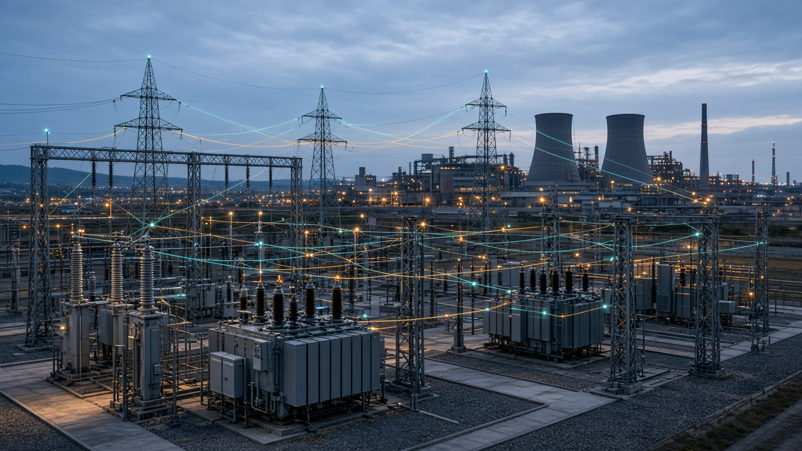

# power-grid-env

[Русский](README.md)



An engineering testbed for distribution-grid control algorithms. The first release is a quasi-static unbalanced feeder: import, preflight, an external controller, a restoration suite, comparison with a baseline, a report, and replay.

The simulator runs locally. A cluster, Kubernetes, and control of a real network are outside this project.

A simulation run is not permission to operate a real network, a real-time guarantee, or a full EMT study.

Full-winding saturated/electrothermal motors, RMS protection/transfer/islanding and independent references: [blocks 6–8 and exact scope (Russian)](docs/EQUIPMENT_AUTOMATION_VALIDATION_RU.md). Native motulator 0.19.0 and exact matrix-exponential references are provided; thermal stress constants are authored, and actual hosted signed EX-04 execution remains required.

Index-1 network DAE, extended dynamic cases and DOL/restart study packs: [implementation, evidence and scope (Russian)](docs/DAE_AND_DOL_BLOCKS_RU.md).

## What is numerically checked, and what is only implemented

Statuses live in `power_grid_env/capabilities.py`.

Checked numerically on authored cases, without field recordings:

- phase-domain power flow through OpenDSSDirect / DSS-Extensions: lines, `Dyn11` and `YNd11` transformers, ZIP loads, faults, an island with no source, and Kron reduction only when the neutral is explicitly solidly grounded;
- DSS import of the 110/10/0.4 kV plant: two infeeds, LineCode, capacitor, generator, storage, PV, a load profile, and Redirect;
- the positive-sequence ladder of that plant matches phase-domain OpenDSS to better than 1e-5 pu in magnitude;
- symmetric Newton AC power flow and a local AC OPF with a branch-flow limit;
- a classical machine, two machines, a first-order field voltage, and governor droop;
- RL/RLC transients and a dt versus dt/2 step check;
- DC power flow, PTDF, and linear WLS on small cases.

Implemented and exercised by scenarios, without a `validated_for_declared_scope` claim: restoration, interlocks, Gymnasium, LLM tools, a VLM canvas, and a local AC OPF. Distance and differential protection, full EMT, and hardware-in-the-loop stay outside this release.

Requirements: [specification](AGENT_IMPLEMENTATION_SPEC_RU.md) and [architecture plan](IMPLEMENTATION_PLAN_RU.md), both in Russian. If they disagree, the specification wins. Equations and assumptions: [docs/physics](docs/physics/conventions.md).

## Install

```bash
pip install -e ".[dev]"
```

For the ANDES backend and full regression suite, use
`pip install -e ".[dev,rms]"`. The qualified ANDES reference has a separate
EX-02 lock file; `dev` alone does not install external simulators.

Python 3.11+ and the `dss-python` / `opendssdirect.py` wheels are required.

## Commands

```bash
power-grid import --source cases/acceptance/feeder_north/feeder.dss \
  --sidecar cases/acceptance/feeder_north/pge-import.yaml \
  --out /tmp/feeder.json --report /tmp/import.json

power-grid preflight /tmp/feeder.json --report /tmp/preflight.json

power-grid suite cases/suites/restoration_v1.yaml --out reports/acceptance

power-grid validate
power-grid accept
power-grid schemas --out /tmp/pge-schemas
power-grid pilot cases/industrial/plant --out /tmp/pilot.json
```

`validate` writes `reports/validation`. `accept` repeats the section 16–20 acceptance path: an external DSS case, rejection of an incomplete file, subprocess controllers, the suite, HTML, checksums, the viewer, replay, numerical checks, and a short Gymnasium rollout.

An external controller is a separate process speaking JSON lines (`initialize`, `reset`, `act`, `close`). Examples live in `examples/controllers`. The subprocess does not isolate the filesystem or the network of untrusted code.

## Model

Canonical JSON does not invent grounding or a vector group. DSS import requires a sidecar; otherwise a wye winding is not treated as grounded, and `r1/x1` are not turned into a phase-impedance matrix. The format choice is recorded in [ADR 0002](docs/adr/0002-import-format.md).

In the restoration task the damaged section is known to the algorithm. Fault impedance, the future load profile, and the scenario's hidden marker stay out of the observation.

## Durable studies

The shared runner returns full phase-domain PF results and executes hold-policy QSTS with a streamed engineering journal, checkpoints and verified continuation. See [runtime guide (Russian)](docs/DURABLE_STUDIES_RU.md). This does not qualify arbitrary RMS models, external feeders, or field accuracy.

```bash
python -m power_grid_env.cli run-study cases/studies/qsts_runtime.json --out /tmp/pge-study
```

Saved balanced networks can now run classical RMS through `rms/andes`: [model scope, units and limitations (Russian)](docs/CANONICAL_RMS_RU.md).

Multivoltage RMS, PV refinement and clock-5 mapping are now covered by additional regressions: [validation and scale limits (Russian)](docs/MULTIVOLTAGE_AND_SCALE_RU.md).

Canonical RMS now includes explicit TGOV1/SEXS/IEEEST passports, finite bus faults with clearance, and a killable worker: [execution, independent references and limits (Russian)](docs/REGULATED_RMS_AND_FAULTS_RU.md).

Six-state GENROU with explicit saturation modes is supported by the shared RMS adapter: [passports, independent references and examples (Russian)](docs/GENROU_RMS_RU.md).

GENCLS/GENROU small-signal analysis now exposes the reduced DAE matrix, modes and state participation, checked against independent references. Dense analysis is limited to 8 machines/256 states; this is local linear stability, without industrial qualification. [Details (Russian)](docs/SMALL_SIGNAL_RU.md).

Network-coupled induction motor starts: single-cage third-order dynamics, voltage sags, contactor coast/reclose and staggered group starts. Checked against an independent SI rotor-flux solver; stator transients, saturation, VFDs and joint synchronous-machine dynamics remain outside this model. [Passports, examples and verification (Russian)](docs/INDUCTION_MOTOR_RU.md).

Added motor current-based thermal memory, continuous threshold trips, latched reclose blocking and strict SI CSV comparison for current/voltage/speed. Synthetic independent references exercise the workflow; OEM relay and field qualification remain open. [Model and examples (Russian)](docs/MOTOR_THERMAL_AND_VALIDATION_RU.md).

Added coupled loaded motor operating-point initialization, viscous/quadratic/smooth-friction shaft loads and explicit load-torque steps. Initialization checks the original ODE residual and local machine stability. [Independent references and scope (Russian)](docs/MOTOR_OPERATING_POINT_RU.md).

Added reproducible motor parameter experiments: OAT/Cartesian points, independent initialization, fixed start/recovery criteria, deadlines and hashed artifacts. Results describe declared finite samples, without interval-wide or field qualification. [Protocol and scope (Russian)](docs/MOTOR_SENSITIVITY_RU.md).

Added unified classical-generator/induction-motor dynamics with one shared nodal solve, joint initialization and motor thermal trips. Independent SI references and an ANDES generator-only limit check cover the declared subset; islanding remains a separate extension. [Scope and verification (Russian)](docs/COUPLED_GENERATOR_MOTOR_RU.md).

Optional TGOV1 governors and SEXS excitation now share the GENCLS/motor solve, with limiter recovery, reference steps and independent SI/ANDES checks. [Scope and reproducible validation (Russian)](docs/REGULATED_COUPLED_RMS_RU.md).

The shared generator/motor solver now accepts six-state GENROU with armature losses, explicit saturation and optional TGOV1/SEXS, including mixed GENCLS/GENROU layouts. [Equations, eight independent references and scope (Russian)](docs/GENROU_COUPLED_RMS_RU.md).

Added finite balanced faults in the shared dynamic network and a `fault-clearing` runner with frozen durations, recovery criteria and hashed isolated-worker artifacts. [Seven independent SI references and scope (Russian)](docs/COUPLED_FAULTS_AND_CLEARING_RU.md). No critical-clearing-time certification is claimed.

Added joint IEEEST MODE=1 and `coupled_small_signal` for local motor/generator/controller modes, including unstable equilibrium reporting and independent SI/transfer-function checks. [Equations and scope (Russian)](docs/COUPLED_PSS_AND_MODES_RU.md).

Added both-end line opening/reclosing in the shared dynamic network, including charging, branch currents/powers and atomic fault clearing. Source-reachability checks reject unsupported islands. [Examples and independent validation (Russian)](docs/COUPLED_LINE_SWITCHING_RU.md).

Added `generator_open`: zero network injection while rotor/field/controllers continue, with machine-side excitation sensing. [Electrical-opening semantics, independent validation and limits (Russian)](docs/GENERATOR_ELECTRICAL_OPEN_RU.md).

The first industrial target is motor starting/restarting. `motor-bundle` seals inputs, replay criteria, runtime identity and optional SI trace comparison; a platform hash lock and clean-venv qualification runner are provided. [Delivery workflow and acceptance gates (Russian)](docs/MOTOR_PILOT_DELIVERY_RU.md). Industrial/field qualification remains open.

[External ANDES motor cross-check, analytic Jacobian and scaling protocol (Russian)](docs/MOTOR_EXTERNAL_VALIDATION_AND_SCALE_RU.md).

[Motor coast, residual terminal voltage and reclose diagnostics (Russian)](docs/MOTOR_COAST_AND_RECLOSE_RU.md).

[Voltage contactors and automatic restart for direct-on-line motors (Russian)](docs/MOTOR_CONTACTOR_AND_AUTOMATIC_RESTART_RU.md).

[Finite restart timing and sequence studies (Russian)](docs/MOTOR_RESTART_FINITE_STUDY_RU.md).

[Restart experiment integrity checks and full replay (Russian)](docs/MOTOR_RESTART_AUDIT_AND_REPLAY_RU.md).

The optional `double_cage` motor uses a physical two-rotor inductance matrix,
including mutual rotor leakage, with mixed motor groups and per-cage current/loss
outputs. It shares the RMS network, contactors, initialization and analytic motor
Jacobian. [Scope and independent checks (Russian)](docs/DOUBLE_CAGE_MOTOR_RU.md).
This remains a numerically checked model, without field or industrial qualification.

Project validation does not require our own hardware: it relies on analytic references, independent simulators and reproducible public cases, supplemented by published measurements. Added 168 steady operating-point checks of the published Aalto motor against motulator 0.19.0. [Method, results and scope (Russian)](docs/OPEN_REFERENCE_VALIDATION_RU.md).

Added reproducible DOL → voltage dip → coast → restart cases, including manual inhibition, restart limits and thermal latching. Checks use an independent SI model, ANDES and analytic coast laws. [Cases and criteria (Russian)](docs/MULTIBUS_DOL_RESTART_VALIDATION_RU.md).

Extended independent generator/motor network checks to 2–4 GENROU/TGOV1/SEXS machines: individual control targets, joint initialization, passport permutations and base changes. Added verified benchmark resumption and a dedicated CI job. [Eight cases, criteria and results (Russian)](docs/MULTI_GENERATOR_VALIDATION_RU.md).

Generator stator thermal memory and latched electrical trips are available; rotor dynamics and cooling continue after opening. Six protected cases match an independent SI model. Eighteen unprotected ANDES baseline runs validate only the interval before opening; post-trip validation uses the SI model and analytic checks. See the [model and validation scope](docs/GENERATOR_STATOR_THERMAL_RU.md) (Russian).

Prescribed-current duty planning now provides analytic thermal headroom, trip time, finite-duration current ceilings and cooling time: `python -m power_grid_env.generator_capability cases/studies/generator_thermal_duty.json`.

A [GENROU field-current feedback limiter](docs/GENERATOR_EXCITATION_LIMITS_RU.md) (Russian documentation) reconstructs field reaction from rotor states, uses an explicit field-current normalization and feeds a bounded droop signal into SEXS. The excitation profile includes continuous controller limit entry/release events and examples covering saturation, recovery, motor starts and generator opening. This is a declared engineering model, not an IEEE/OEM OEL.

After the excitation section, the complete current collection is verified: **1152 tests**, including 64 new tests, with no skips or unresolved failures. Tests ran in bounded file batches; excitation documentation records reproduction details and external-reference scope.

The next implementation package adds shared exact controller boundaries, actual runtime/output limits, rotor field thermal memory, explicit motor-start acceptance and short-window radial RMS measurements up to 10000 nodes. A separate full-stator-flux component is compared against native motulator dynamics. [Commands and validation scope](docs/INDUSTRIAL_SEQUENCE_RU.md) (Russian).


A specific **MNLEX2 OpenIPSL 3.1.0 UEL** now provides machine-base sensing,
AVR feedback, explicit raw states and atomic resets, inactive equilibrium
initialization and coordination with OEL/field protection. The original
component runs in independent OpenModelica/DASSL; the complete network feedback
is checked against a separate SI model. [Equations, scope and reproduction](docs/MNLEX2_VALIDATION_RU.md) (Russian).

An eight-state **OEL2C** adds delays, inverse-time operation, anti-windup,
recovery and nonpositive SEXS summation feedback. A native Modelica block
runs through FMI 2 Model Exchange/CVODE in a closed loop with an independent
SI generator/motor network. The explicitly named `Dynawo cap-guard-v1`
variant adds an upper-cap recognition band; raw-source diagnostics are
retained separately. The adapted source file is MPL-2.0, with its license
included in the wheel. [Equations, initialization and reproduction](docs/OEL2C_VALIDATION_RU.md) (Russian).

OEL2C now supports explicit `inactive_equilibrium` initialization with loaded
machines and motors, including all eight states, anti-windup and initial timer
memory. Active and boundary initial points are rejected explicitly.
[Native validation and equilibrium scope](docs/OEL2C_EQUILIBRIUM_RU.md) (Russian).

OEL2C `active_limited_equilibrium` initializes a loaded operating point with
exhausted PID authority, an explicit AVR reference policy and separate thermal
reference excess diagnostics. Native checks cover limiter release and field
protection. [Equations, reference audit and scope](docs/OEL2C_ACTIVE_EQUILIBRIUM_RU.md) (Russian).

OEL2C now supports joint field-current-constrained network equilibrium with a specified AVR input and interior PID authority. Initial terminal voltage is solved explicitly. Independent SI/native-FMU checks include the full conditional regulating spectrum. [Inputs, examples and validation scope](docs/OEL2C_CURRENT_REGULATION_RU.md) (Russian).

OEL2C `selected_equilibrium` adds explicit stationary active-set selection, neutral reference/PID memory and zero-rate timer contacts. Ambiguous inputs are rejected; stationarity is reported separately from full OEL stability. [Inputs and independent validation](docs/OEL2C_SELECTED_EQUILIBRIUM_RU.md) (Russian).

OEL2C now offers finite coincident-guard checks: benign equivalent modes are accepted, sensitive starts are rejected with explicit witnesses. Physical input and thresholds remain unchanged. The Python thermal guard preserves the original Modelica operation order at rounding-sensitive release points. Independent SI/FMU checks include native component derivatives at neighboring points. [Policy, limits and commands](docs/OEL2C_BOUNDARY_POLICY_RU.md) (Russian).

A five-state ESST1A profile adds explicit absolute OEL takeover, UEL and
supplementary input ports. The unmodified OpenIPSL FMU is compared in feedback
with an independent SI network, including fault clearing and field thermal trips.
[Connections, reproduction and EX-02 limitations](docs/ESST1A_VALIDATION_RU.md).

[Joint native ESST1A/MNLEX2 validation](docs/ESST1A_MNLEX2_JOINT_VALIDATION_RU.md)
puts both original OpenIPSL models in closed network feedback. Raw states and
reset event sides are checked; a timing-sensitive two-UEL case is explicitly
retained as a negative witness rather than qualified.

The audit checks every reset and all physical channels even for an expected
negative witness. Sealed evidence can be rechecked using a pinned SHA-256
without rebuilding FMUs; the qualification event limit remains 1 microsecond.

Independent step and tolerance refinement now checks both solvers. Causal FMU event
routing also validates the two-active-UEL stress case, eliminating the former
0.173 s discrepancy in the reference adapter. Continuous atomic roots also resolve the nearly
stationary case: all 13 registered scenarios agree at two accuracies within
the unchanged 1 microsecond limit. Self-convergence does not establish
cross-solver agreement.

The causal validator now requires an audit of source conditions and both sides
of each native reset. Sealed trajectories can be rechecked using pinned SHA-256
without executing FMUs; local roundoff sensitivity remains diagnostic.

EX-02 adds the explicitly named dynamic absolute OEL
`FieldCurrentPI_AbsoluteTakeover_v1`, an explicit IEEEST connection to ESST1A,
and local ESST1A/PSS/OEL modal analysis. Independent references use an SI
network and pinned OpenIPSL/MSL FMUs; `benchmarks.ex02_cases` registers the
joint disturbance and modal corpus. Qualification is limited to the declared
engineering profiles; OEM controllers, arbitrary hybrid modes and EMT remain
outside this scope.

Examples: `power-grid run-study cases/studies/ex02_overload_recovery.json
--out reports/ex02-example` and `power-grid run-study
cases/studies/ex02_modal_avr_pss_oel.json --out reports/ex02-modal`.
[Connection contract, reproduction and isolated dependencies (Russian)](docs/ESST1A_VALIDATION_RU.md).

EX-03 adds 45-second runup, coast, restart and cooling cases, a 30-second
ESST1A cross-check, and five measured dynamic configurations up to
`(2000 nodes, 8 motors, 4 generators)`. An independent sparse SI/MNA model
checks internal states and every node's complex voltage.
[Cases, exact scale limits and reproduction (Russian)](docs/EX03_LONG_RUN_AND_SCALE_RU.md).

EX-04 introduces a [reproducible release candidate](docs/EX04_REPRODUCIBLE_RELEASE_RU.md):
frozen source, a hash-locked offline wheelhouse, retained dependency notices,
a complete collected-test inventory, and an explicit Linux x86_64 / Python 3.12
profile. Required tests must pass setup, call and teardown without skip/xfail;
tests outside the profile are listed separately and never counted as passed.
Source, wheel and test inventory identities are bound in an execution receipt.
Independent release qualification remains pending an actual remote CI run and
verification of artifact provenance. Local installations do not establish it.

Fixed-field GENCLS networks now use an [analytic coupled Jacobian](docs/COUPLED_JACOBIAN_RU.md)
with single/double-cage motors and thermal replicas. It includes mutual machine
sensitivities and invalidates the network response after switching. GENROU and
controller extensions are described below.


The [piecewise analytic GENROU/TGOV1/SEXS Jacobian](docs/GENROU_JACOBIAN_RU.md)
extends this path to saturation, declared controller limit branches, mixed
GENCLS/GENROU networks and stator thermal trips. Further profiles cover PSS, authored droop OEL, ESST1A, MNLEX2 and rotor I² protection; single-OEL2C is described below. Event saltation matrices are
outside this derivative contract.


The [IEEEST and droop-OEL analytic profile](docs/PSS_DROOP_JACOBIAN_RU.md)
adds seven PSS states, strict voltage gating, and authored two-state field-current
feedback. A separate physical SI circuit and polynomial PSS realization check
the joint closed loop. This authored OEL does not claim IEEE/OEM equivalence.


The [ESST1A and absolute PI-OEL analytic profile](docs/ESST1A_JACOBIAN_RU.md)
adds five exciter-state derivatives, selectors, moving rectifier bounds and
back-calculation. A pinned OpenIPSL/MSL model in an independent SI network
checks this profile. UEL/OEL2C remain outside this analytic path.

MNLEX2 and rotor I² protection now have analytic derivatives coupled to AVR/PSS/PI-OEL: [NA-05 scope and reproduction](docs/PROTECTION_JACOBIAN_RU.md).

[Analytic OEL2C (NA-06)](docs/OEL2C_JACOBIAN_RU.md) adds all eight limiter states and network coupling at the current clock/active set. Automatic routing is restricted to one OEL2C; multiple OEL2Cs retain FD following a preserved coincident-event ordering witness.

[NA-07: independent OEL2C below-clock batching](docs/OEL2C_EVENT_BATCH_RU.md) adds the explicit `independent_below_clock_batch_v1` policy for multiple limiters. Legacy inputs retain their previous event handling and FD routing; opted-in cases have a separate qualification corpus.

[NA-08: blocked network sensitivities and CSC](docs/JACOBIAN_SCALING_RU.md) limits temporary RHS blocks to eight ports and retains only requested rows. Explicit `jacobian_format: csc` enables exact CSC delivery to Radau/SuperLU; dense remains the default. NA-08 used dense assembly; NA-09 below adds streamed assembly.

[NA-09: streamed CSC assembly](docs/STREAMED_JACOBIAN_RU.md) builds supported analytic Jacobians in blocks of up to 32 columns without full dense state-square identity/result buffers for larger systems. New checks cover 400/424 states with 8 generators, 32 double-cage motors and controllers. Final CSC and port responses may still be dense.

[NA-10: independent eight-machine reference](docs/EIGHT_MACHINE_NATIVE_RU.md) checks the unchanged NA-09 scenarios (8 generators, 32 motors, PSS and excitation limiters), both rotor cages, and thermal trip/reclose interlocking. Qualification depends on the bound report; industrial qualification and independent release-host EX-04 remain separate requirements.

[NA-11: direct network tangents and J·v](docs/NETWORK_TANGENTS_RU.md) adds explicit `jacobian_network: direct_solve` for CSC and analytic Jacobian-vector products without a full matrix or dense port response. Radau still uses CSC/SuperLU. See the document for qualification scope and limits.
