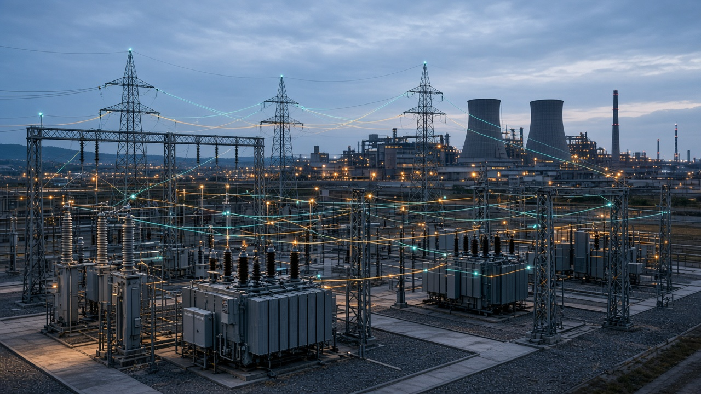

# power-grid-env

**Separate interfaces:** the [project website and journal](web/README.md) build as independent static pages. [Power Grid Studio](studio/README.md) runs separately with the editor, visualization, study API and agent tools.

**GPU engineering-agent SFT:** on the first held-out six-task synthetic catalogue test, Qwen3.5-4B improved from0/6 to5/6;0.8B from0/6 to3/6. Three networks/two topology families; text-only, no general engineering qualification. [Scope and current results](plans/CURRENT_STATUS.md).

Expanded TRAIN decision-state coverage:4B solves28/30 previously disclosed regression tasks; this is not a new held-out test.

**AC PF:** PQ/I/ZIP loads, static PQ/PV generators, reactive limits and reverse flows in the [engineering web workspace](studio/README.md).

**Engineering web workspace:** manual RMS grids with transformers, passive PF/finite-Z three-phase faults, static switch states and deenergized sections. [Startup and profile scope](studio/README.md).

**Manual network editor:** buses, lines and motor parameters → validation → local SciPy simulation → Grid Studio. Bounded balanced radial motor-start profile. [Startup and scope](studio/README.md).

**Grid Studio:** interactive single-line diagrams, power flows, equipment inspection and waveforms from12 recorded physical studies. [Local startup and scope](studio/README.md).

Two-cage RMS R(T):individual cage currents/losses,common rotor heating and
joint stationary equilibrium —
[R06.40:120 runs and66 independent trajectories](cases/two-cage-winding/README.md).

Joint RMS electrical/mechanical/thermal equilibrium: speed,current and winding
temperatures solved together,with heat-balance checks in watts —
[R06.39 scope and reproduction](cases/rms-equilibrium/README.md).

RMS/DAE electrothermal feedback: state-dependent R(T) network stamps and
analytic Newton actions,128 runs and64 independent trajectories —
[R06.38 scope and reproduction](cases/rms-winding/README.md).

Hot winding states and dynamic R(T) fault feedback: separate stator/rotor
temperatures,120 phase-domain runs and60 independent trajectories —
[R06.37 scope and reproduction](cases/electrothermal-fault/README.md).

Independent hybrid OC/UV/thermal validation:78 SI winding trajectories,
breaker failure, CT restoration and Radau/DAE comparisons —
[R06.36 coverage and reproduction](cases/motor-only-loaded/README.md#r0636--независимая-гибридная-динамика-защит).

Registered AC/pandapower, RMS/ANDES and full-winding/motulator comparisons
with explicit coverage and no unsupported speed claims: [R01.1 protocol](docs/COMPARISON_PROTOCOL_RU.md).

Motor start/restart studies now include shaft-work balance, I²t, thermal-replica
checks and three-grid engineering decisions: [scope and commands](docs/MOTOR_ENGINEERING_RU.md).

Independent continuous checks now cover saturated multicage drives, losses and
heating: [six executable PHY-20 cases](cases/multicage-continuous/README.md).
The two–four-cage equations are separate from runtime; the single-cage limit is
checked against original motulator. Qualification is limited to the stated cases.

Separate PHY-21 tracks cover 2000 buses / 128 motors / 32 generators, 45-second
islands, protection cascades and phase RLC transients:
[measured matrix and exact coverage](cases/network-dynamic/README.md).

Feeder design now checks every scenario on three grids, audits the results and
provides topology-held-out decision/refusal examples:
[DES-01 scope and commands](cases/design-curriculum/README.md).

Cable and transformer selection with combined static and dynamic checks:
[DES-02 profile and commands](cases/equipment-design/README.md).

Published manufacturer data with field-level provenance and deterministic compilation:
[DES-02 catalog profile](cases/equipment-catalog/README.md).

Sampled start pickup and discrete primary/backup relay coordination:
[protection screen](cases/protection-screen/README.md).

Closed-loop relay and breaker actions in a motor-only network:
[closed-loop protection](cases/closed-loop-protection/README.md).

Inverse-time relay clock replay and all16 pickup/time tolerance corners:
[inverse protection](cases/inverse-protection/README.md).

Full start, sag and restart studies at all16 tolerance corners, Radau/DAE:
[full protection envelope](cases/full-protection-envelope/README.md).

Full inverse-family corner matrices and an explicitly verified backup-setting revision:
[VI/EI family qualification](cases/full-inverse-families/README.md).

Verified LLM task generation, SFT conversations, physical GRPO rewards and local
checkpoint training/evaluation: [guide](docs/LLM_TRAINING_EN.md).
The first profile is feeder restoration; trained engineering-LLM quality and
superiority over other simulators have not been established.

[Русский](README.md)

[Current status, remaining blocks and work queue (Russian)](plans/CURRENT_STATUS.md)

Validation and delivery run locally. CI is disabled; the agent does not interact with GitHub.



An engineering testbed for distribution-grid control algorithms. The first release is a quasi-static unbalanced feeder: import, preflight, an external controller, a restoration suite, comparison with a baseline, a report, and replay.

The simulator runs locally. A cluster, Kubernetes, and control of a real network are outside this project.

A simulation run is not permission to operate a real network, a real-time guarantee, or a full EMT study.

Additional profiles cover analytic automation with DAE, independent multi-cage network references, eddy-current losses, parameter identification and common-ground phase faults.

Independent network checks now cover meshed saturated-motor circuits, transformers and multiple sources; standby transfer has a separate SI reference.

Full-winding saturated/electrothermal motors, RMS protection/transfer/islanding and independent references: [blocks 6–8 and exact scope (Russian)](docs/EQUIPMENT_AUTOMATION_VALIDATION_RU.md). Native motulator 0.19.0 and exact matrix-exponential references are provided; thermal stress constants are authored, and external EX-04 has been cancelled by the user; local reproducibility is the delivery gate.

Index-1 network DAE, extended dynamic cases and DOL/restart study packs: [implementation, evidence and scope (Russian)](docs/DAE_AND_DOL_BLOCKS_RU.md).

## What is numerically checked, and what is only implemented

Statuses live in `power_grid_env/capabilities.py`.

Checked numerically on authored cases, without field recordings:

- phase-domain power flow through OpenDSSDirect / DSS-Extensions: lines, `Dyn11` and `YNd11` transformers, ZIP loads, faults, an island with no source, and Kron reduction only when the neutral is explicitly solidly grounded;
- DSS import of the 110/10/0.4 kV plant: two infeeds, LineCode, capacitor, generator, storage, PV, a load profile, and Redirect;
- the positive-sequence ladder of that plant matches phase-domain OpenDSS to better than 1e-5 pu in magnitude;
- symmetric Newton AC power flow and a local AC OPF with a branch-flow limit;
- a classical machine, two machines, a first-order field voltage, and governor droop;
- RL/RLC transients and a dt versus dt/2 step check;
- DC power flow, PTDF, and linear WLS on small cases.

Implemented and exercised by scenarios, without a `validated_for_declared_scope` claim: restoration, interlocks, Gymnasium, LLM tools, a VLM canvas, and a local AC OPF. Distance and differential protection, full EMT, and hardware-in-the-loop stay outside this release.

Requirements: [specification](AGENT_IMPLEMENTATION_SPEC_RU.md) and [architecture plan](IMPLEMENTATION_PLAN_RU.md), both in Russian. If they disagree, the specification wins. Equations and assumptions: [docs/physics](docs/physics/conventions.md).

## Install

```bash
pip install -e ".[dev]"
```

For the ANDES backend and full regression suite, use
`pip install -e ".[dev,rms]"`. The qualified ANDES reference has a separate
EX-02 lock file; `dev` alone does not install external simulators.

Python 3.11+ and the `dss-python` / `opendssdirect.py` wheels are required.

## Commands

```bash
power-grid import --source cases/acceptance/feeder_north/feeder.dss \
  --sidecar cases/acceptance/feeder_north/pge-import.yaml \
  --out /tmp/feeder.json --report /tmp/import.json

power-grid preflight /tmp/feeder.json --report /tmp/preflight.json

power-grid suite cases/suites/restoration_v1.yaml --out reports/acceptance

power-grid validate
power-grid accept
power-grid schemas --out /tmp/pge-schemas
power-grid pilot cases/industrial/plant --out /tmp/pilot.json
```

`validate` writes `reports/validation`. `accept` repeats the section 16–20 acceptance path: an external DSS case, rejection of an incomplete file, subprocess controllers, the suite, HTML, checksums, the viewer, replay, numerical checks, and a short Gymnasium rollout.

An external controller is a separate process speaking JSON lines (`initialize`, `reset`, `act`, `close`). Examples live in `examples/controllers`. The subprocess does not isolate the filesystem or the network of untrusted code.

### Limits along an AC solution branch

```bash
power-grid ac-envelope --input cases/ac-envelope/analytic-exits.json --out reports/my-ac-envelope
power-grid verify-ac-envelope reports/my-ac-envelope
```

Continuation with Q-limit control supports Vmin/Vmax, terminal apparent-power
ratings and separately specified pu-current limits. Artifacts include refined
entry/exit intervals, initial violations and worst observed margins.
`completed=true` means the study finished; the exact target's limit status is
reported separately as `target_within_monitored_limits`. The analytical example
reaches a target that violates limits.

IEEE14/30/118 were compared with independent pandapower solves at two step sizes.
Example current thresholds are author-defined demonstrations, not equipment
ampere ratings. Monitoring does not trip equipment or exclude hidden crossings
between samples. See the [comparison protocol](docs/COMPARISON_PROTOCOL_RU.md)
for the bounded qualification scope.

### Bounded distributed balancing

```bash
power-grid ac-dispatch --input cases/ac-dispatch/slack-q-limit.json --out reports/my-ac-dispatch
power-grid verify-ac-dispatch reports/my-ac-dispatch
```

Explicit participation weights share the active imbalance within P limits.
The former slack's Q limit can release its voltage without losing the phase
reference; the angle reference can be selected separately. All initial Pg
schedules must be explicit. The same static profile is connected to CPF/envelope via `options.dispatch`
with `enforce_q_limits=true`. Frequency dynamics and automatic islanding are
outside this profile.

### Distributed continuation and operating envelope

```bash
power-grid ac-envelope --input cases/ac-dispatch-arc/analytic-entry.json --out reports/my-dispatch-envelope
power-grid verify-ac-envelope reports/my-dispatch-envelope
```

P saturation/release, Q limits on all voltage controllers and network limits
use the same solution branch. Detected events are combined in `timeline_groups`;
the exact target's limit status remains a separate flag.
Pure CPF example: `cases/ac-pseudo-arc/distributed-participation.json`.

## Model

Canonical JSON does not invent grounding or a vector group. DSS import requires a sidecar; otherwise a wye winding is not treated as grounded, and `r1/x1` are not turned into a phase-impedance matrix. The format choice is recorded in [ADR 0002](docs/adr/0002-import-format.md).

In the restoration task the damaged section is known to the algorithm. Fault impedance, the future load profile, and the scenario's hidden marker stay out of the observation.

## Durable studies

The shared runner returns full phase-domain PF results and executes hold-policy QSTS with a streamed engineering journal, checkpoints and verified continuation. See [runtime guide (Russian)](docs/DURABLE_STUDIES_RU.md). This does not qualify arbitrary RMS models, external feeders, or field accuracy.

```bash
python -m power_grid_env.cli run-study cases/studies/qsts_runtime.json --out /tmp/pge-study
```

Saved balanced networks can now run classical RMS through `rms/andes`: [model scope, units and limitations (Russian)](docs/CANONICAL_RMS_RU.md).

Multivoltage RMS, PV refinement and clock-5 mapping are now covered by additional regressions: [validation and scale limits (Russian)](docs/MULTIVOLTAGE_AND_SCALE_RU.md).

Canonical RMS now includes explicit TGOV1/SEXS/IEEEST passports, finite bus faults with clearance, and a killable worker: [execution, independent references and limits (Russian)](docs/REGULATED_RMS_AND_FAULTS_RU.md).

Six-state GENROU with explicit saturation modes is supported by the shared RMS adapter: [passports, independent references and examples (Russian)](docs/GENROU_RMS_RU.md).

GENCLS/GENROU small-signal analysis now exposes the reduced DAE matrix, modes and state participation, checked against independent references. Dense analysis is limited to 8 machines/256 states; this is local linear stability, without industrial qualification. [Details (Russian)](docs/SMALL_SIGNAL_RU.md).

Network-coupled induction motor starts: single-cage third-order dynamics, voltage sags, contactor coast/reclose and staggered group starts. Checked against an independent SI rotor-flux solver; stator transients, saturation, VFDs and joint synchronous-machine dynamics remain outside this model. [Passports, examples and verification (Russian)](docs/INDUCTION_MOTOR_RU.md).

Added motor current-based thermal memory, continuous threshold trips, latched reclose blocking and strict SI CSV comparison for current/voltage/speed. Synthetic independent references exercise the workflow; OEM relay and field qualification remain open. [Model and examples (Russian)](docs/MOTOR_THERMAL_AND_VALIDATION_RU.md).

Added coupled loaded motor operating-point initialization, viscous/quadratic/smooth-friction shaft loads and explicit load-torque steps. Initialization checks the original ODE residual and local machine stability. [Independent references and scope (Russian)](docs/MOTOR_OPERATING_POINT_RU.md).

Added reproducible motor parameter experiments: OAT/Cartesian points, independent initialization, fixed start/recovery criteria, deadlines and hashed artifacts. Results describe declared finite samples, without interval-wide or field qualification. [Protocol and scope (Russian)](docs/MOTOR_SENSITIVITY_RU.md).

Added unified classical-generator/induction-motor dynamics with one shared nodal solve, joint initialization and motor thermal trips. Independent SI references and an ANDES generator-only limit check cover the declared subset; islanding remains a separate extension. [Scope and verification (Russian)](docs/COUPLED_GENERATOR_MOTOR_RU.md).

Optional TGOV1 governors and SEXS excitation now share the GENCLS/motor solve, with limiter recovery, reference steps and independent SI/ANDES checks. [Scope and reproducible validation (Russian)](docs/REGULATED_COUPLED_RMS_RU.md).

The shared generator/motor solver now accepts six-state GENROU with armature losses, explicit saturation and optional TGOV1/SEXS, including mixed GENCLS/GENROU layouts. [Equations, eight independent references and scope (Russian)](docs/GENROU_COUPLED_RMS_RU.md).

Added finite balanced faults in the shared dynamic network and a `fault-clearing` runner with frozen durations, recovery criteria and hashed isolated-worker artifacts. [Seven independent SI references and scope (Russian)](docs/COUPLED_FAULTS_AND_CLEARING_RU.md). No critical-clearing-time certification is claimed.

Added joint IEEEST MODE=1 and `coupled_small_signal` for local motor/generator/controller modes, including unstable equilibrium reporting and independent SI/transfer-function checks. [Equations and scope (Russian)](docs/COUPLED_PSS_AND_MODES_RU.md).

Added both-end line opening/reclosing in the shared dynamic network, including charging, branch currents/powers and atomic fault clearing. Source-reachability checks reject unsupported islands. [Examples and independent validation (Russian)](docs/COUPLED_LINE_SWITCHING_RU.md).

Added `generator_open`: zero network injection while rotor/field/controllers continue, with machine-side excitation sensing. [Electrical-opening semantics, independent validation and limits (Russian)](docs/GENERATOR_ELECTRICAL_OPEN_RU.md).

The first industrial target is motor starting/restarting. `motor-bundle` seals inputs, replay criteria, runtime identity and optional SI trace comparison; a platform hash lock and clean-venv qualification runner are provided. [Delivery workflow and acceptance gates (Russian)](docs/MOTOR_PILOT_DELIVERY_RU.md). Industrial/field qualification remains open.

[External ANDES motor cross-check, analytic Jacobian and scaling protocol (Russian)](docs/MOTOR_EXTERNAL_VALIDATION_AND_SCALE_RU.md).

[Motor coast, residual terminal voltage and reclose diagnostics (Russian)](docs/MOTOR_COAST_AND_RECLOSE_RU.md).

[Voltage contactors and automatic restart for direct-on-line motors (Russian)](docs/MOTOR_CONTACTOR_AND_AUTOMATIC_RESTART_RU.md).

[Finite restart timing and sequence studies (Russian)](docs/MOTOR_RESTART_FINITE_STUDY_RU.md).

[Restart experiment integrity checks and full replay (Russian)](docs/MOTOR_RESTART_AUDIT_AND_REPLAY_RU.md).

The optional `double_cage` motor uses a physical two-rotor inductance matrix,
including mutual rotor leakage, with mixed motor groups and per-cage current/loss
outputs. It shares the RMS network, contactors, initialization and analytic motor
Jacobian. [Scope and independent checks (Russian)](docs/DOUBLE_CAGE_MOTOR_RU.md).
This remains a numerically checked model, without field or industrial qualification.

Project validation does not require our own hardware: it relies on analytic references, independent simulators and reproducible public cases, supplemented by published measurements. Added 168 steady operating-point checks of the published Aalto motor against motulator 0.19.0. [Method, results and scope (Russian)](docs/OPEN_REFERENCE_VALIDATION_RU.md).

Added reproducible DOL → voltage dip → coast → restart cases, including manual inhibition, restart limits and thermal latching. Checks use an independent SI model, ANDES and analytic coast laws. [Cases and criteria (Russian)](docs/MULTIBUS_DOL_RESTART_VALIDATION_RU.md).

Extended independent generator/motor network checks to 2–4 GENROU/TGOV1/SEXS machines: individual control targets, joint initialization, passport permutations and base changes. Added locally verified benchmark resumption. [Eight cases, criteria and results (Russian)](docs/MULTI_GENERATOR_VALIDATION_RU.md).

Generator stator thermal memory and latched electrical trips are available; rotor dynamics and cooling continue after opening. Six protected cases match an independent SI model. Eighteen unprotected ANDES baseline runs validate only the interval before opening; post-trip validation uses the SI model and analytic checks. See the [model and validation scope](docs/GENERATOR_STATOR_THERMAL_RU.md) (Russian).

Prescribed-current duty planning now provides analytic thermal headroom, trip time, finite-duration current ceilings and cooling time: `python -m power_grid_env.generator_capability cases/studies/generator_thermal_duty.json`.

A [GENROU field-current feedback limiter](docs/GENERATOR_EXCITATION_LIMITS_RU.md) (Russian documentation) reconstructs field reaction from rotor states, uses an explicit field-current normalization and feeds a bounded droop signal into SEXS. The excitation profile includes continuous controller limit entry/release events and examples covering saturation, recovery, motor starts and generator opening. This is a declared engineering model, not an IEEE/OEM OEL.

After the excitation section, the complete current collection is verified: **1152 tests**, including 64 new tests, with no skips or unresolved failures. Tests ran in bounded file batches; excitation documentation records reproduction details and external-reference scope.

The next implementation package adds shared exact controller boundaries, actual runtime/output limits, rotor field thermal memory, explicit motor-start acceptance and short-window radial RMS measurements up to 10000 nodes. A separate full-stator-flux component is compared against native motulator dynamics. [Commands and validation scope](docs/INDUSTRIAL_SEQUENCE_RU.md) (Russian).


A specific **MNLEX2 OpenIPSL 3.1.0 UEL** now provides machine-base sensing,
AVR feedback, explicit raw states and atomic resets, inactive equilibrium
initialization and coordination with OEL/field protection. The original
component runs in independent OpenModelica/DASSL; the complete network feedback
is checked against a separate SI model. [Equations, scope and reproduction](docs/MNLEX2_VALIDATION_RU.md) (Russian).

An eight-state **OEL2C** adds delays, inverse-time operation, anti-windup,
recovery and nonpositive SEXS summation feedback. A native Modelica block
runs through FMI 2 Model Exchange/CVODE in a closed loop with an independent
SI generator/motor network. The explicitly named `Dynawo cap-guard-v1`
variant adds an upper-cap recognition band; raw-source diagnostics are
retained separately. The adapted source file is MPL-2.0, with its license
included in the wheel. [Equations, initialization and reproduction](docs/OEL2C_VALIDATION_RU.md) (Russian).

OEL2C now supports explicit `inactive_equilibrium` initialization with loaded
machines and motors, including all eight states, anti-windup and initial timer
memory. Active and boundary initial points are rejected explicitly.
[Native validation and equilibrium scope](docs/OEL2C_EQUILIBRIUM_RU.md) (Russian).

OEL2C `active_limited_equilibrium` initializes a loaded operating point with
exhausted PID authority, an explicit AVR reference policy and separate thermal
reference excess diagnostics. Native checks cover limiter release and field
protection. [Equations, reference audit and scope](docs/OEL2C_ACTIVE_EQUILIBRIUM_RU.md) (Russian).

OEL2C now supports joint field-current-constrained network equilibrium with a specified AVR input and interior PID authority. Initial terminal voltage is solved explicitly. Independent SI/native-FMU checks include the full conditional regulating spectrum. [Inputs, examples and validation scope](docs/OEL2C_CURRENT_REGULATION_RU.md) (Russian).

OEL2C `selected_equilibrium` adds explicit stationary active-set selection, neutral reference/PID memory and zero-rate timer contacts. Ambiguous inputs are rejected; stationarity is reported separately from full OEL stability. [Inputs and independent validation](docs/OEL2C_SELECTED_EQUILIBRIUM_RU.md) (Russian).

OEL2C now offers finite coincident-guard checks: benign equivalent modes are accepted, sensitive starts are rejected with explicit witnesses. Physical input and thresholds remain unchanged. The Python thermal guard preserves the original Modelica operation order at rounding-sensitive release points. Independent SI/FMU checks include native component derivatives at neighboring points. [Policy, limits and commands](docs/OEL2C_BOUNDARY_POLICY_RU.md) (Russian).

A five-state ESST1A profile adds explicit absolute OEL takeover, UEL and
supplementary input ports. The unmodified OpenIPSL FMU is compared in feedback
with an independent SI network, including fault clearing and field thermal trips.
[Connections, reproduction and EX-02 limitations](docs/ESST1A_VALIDATION_RU.md).

[Joint native ESST1A/MNLEX2 validation](docs/ESST1A_MNLEX2_JOINT_VALIDATION_RU.md)
puts both original OpenIPSL models in closed network feedback. Raw states and
reset event sides are checked; a timing-sensitive two-UEL case is explicitly
retained as a negative witness rather than qualified.

The audit checks every reset and all physical channels even for an expected
negative witness. Sealed evidence can be rechecked using a pinned SHA-256
without rebuilding FMUs; the qualification event limit remains 1 microsecond.

Independent step and tolerance refinement now checks both solvers. Causal FMU event
routing also validates the two-active-UEL stress case, eliminating the former
0.173 s discrepancy in the reference adapter. Continuous atomic roots also resolve the nearly
stationary case: all 13 registered scenarios agree at two accuracies within
the unchanged 1 microsecond limit. Self-convergence does not establish
cross-solver agreement.

The causal validator now requires an audit of source conditions and both sides
of each native reset. Sealed trajectories can be rechecked using pinned SHA-256
without executing FMUs; local roundoff sensitivity remains diagnostic.

EX-02 adds the explicitly named dynamic absolute OEL
`FieldCurrentPI_AbsoluteTakeover_v1`, an explicit IEEEST connection to ESST1A,
and local ESST1A/PSS/OEL modal analysis. Independent references use an SI
network and pinned OpenIPSL/MSL FMUs; `benchmarks.ex02_cases` registers the
joint disturbance and modal corpus. Qualification is limited to the declared
engineering profiles; OEM controllers, arbitrary hybrid modes and EMT remain
outside this scope.

Examples: `power-grid run-study cases/studies/ex02_overload_recovery.json
--out reports/ex02-example` and `power-grid run-study
cases/studies/ex02_modal_avr_pss_oel.json --out reports/ex02-modal`.
[Connection contract, reproduction and isolated dependencies (Russian)](docs/ESST1A_VALIDATION_RU.md).

EX-03 adds 45-second runup, coast, restart and cooling cases, a 30-second
ESST1A cross-check, and five measured dynamic configurations up to
`(2000 nodes, 8 motors, 4 generators)`. An independent sparse SI/MNA model
checks internal states and every node's complex voltage.
[Cases, exact scale limits and reproduction (Russian)](docs/EX03_LONG_RUN_AND_SCALE_RU.md).

Local delivery uses a [reproducible release candidate](docs/EX04_REPRODUCIBLE_RELEASE_RU.md):
frozen source, a hash-locked offline wheelhouse, retained dependency notices,
a complete collected-test inventory, and an explicit Linux x86_64 / Python 3.12
profile. Required tests must pass setup, call and teardown without skip/xfail;
tests outside the profile are listed separately and never counted as passed.
Source, wheel and test inventory identities are bound in an execution receipt.
The former external EX-04 requirement has been cancelled by the user. CI,
publication and external signatures are not delivery gates; local installations establish local reproducibility.

Fixed-field GENCLS networks now use an [analytic coupled Jacobian](docs/COUPLED_JACOBIAN_RU.md)
with single/double-cage motors and thermal replicas. It includes mutual machine
sensitivities and invalidates the network response after switching. GENROU and
controller extensions are described below.


The [piecewise analytic GENROU/TGOV1/SEXS Jacobian](docs/GENROU_JACOBIAN_RU.md)
extends this path to saturation, declared controller limit branches, mixed
GENCLS/GENROU networks and stator thermal trips. Further profiles cover PSS, authored droop OEL, ESST1A, MNLEX2 and rotor I² protection; single-OEL2C is described below. Event saltation matrices are
outside this derivative contract.


The [IEEEST and droop-OEL analytic profile](docs/PSS_DROOP_JACOBIAN_RU.md)
adds seven PSS states, strict voltage gating, and authored two-state field-current
feedback. A separate physical SI circuit and polynomial PSS realization check
the joint closed loop. This authored OEL does not claim IEEE/OEM equivalence.


The [ESST1A and absolute PI-OEL analytic profile](docs/ESST1A_JACOBIAN_RU.md)
adds five exciter-state derivatives, selectors, moving rectifier bounds and
back-calculation. A pinned OpenIPSL/MSL model in an independent SI network
checks this profile. UEL/OEL2C remain outside this analytic path.

MNLEX2 and rotor I² protection now have analytic derivatives coupled to AVR/PSS/PI-OEL: [NA-05 scope and reproduction](docs/PROTECTION_JACOBIAN_RU.md).

[Analytic OEL2C (NA-06)](docs/OEL2C_JACOBIAN_RU.md) adds all eight limiter states and network coupling at the current clock/active set. Automatic routing is restricted to one OEL2C; multiple OEL2Cs retain FD following a preserved coincident-event ordering witness.

[NA-07: independent OEL2C below-clock batching](docs/OEL2C_EVENT_BATCH_RU.md) adds the explicit `independent_below_clock_batch_v1` policy for multiple limiters. Legacy inputs retain their previous event handling and FD routing; opted-in cases have a separate qualification corpus.

[NA-08: blocked network sensitivities and CSC](docs/JACOBIAN_SCALING_RU.md) limits temporary RHS blocks to eight ports and retains only requested rows. Explicit `jacobian_format: csc` enables exact CSC delivery to Radau/SuperLU; dense remains the default. NA-08 used dense assembly; NA-09 below adds streamed assembly.

[NA-09: streamed CSC assembly](docs/STREAMED_JACOBIAN_RU.md) builds supported analytic Jacobians in blocks of up to 32 columns without full dense state-square identity/result buffers for larger systems. New checks cover 400/424 states with 8 generators, 32 double-cage motors and controllers. Final CSC and port responses may still be dense.

[NA-10: independent eight-machine reference](docs/EIGHT_MACHINE_NATIVE_RU.md) checks the unchanged NA-09 scenarios (8 generators, 32 motors, PSS and excitation limiters), both rotor cages, and thermal trip/reclose interlocking. Qualification depends on the bound report; general industrial qualification remains separate; the external EX-04 requirement has been cancelled by the user.

[NA-11: direct network tangents and J·v](docs/NETWORK_TANGENTS_RU.md) adds explicit `jacobian_network: direct_solve` for CSC and analytic Jacobian-vector products without a full matrix or dense port response. Radau still uses CSC/SuperLU. See the document for qualification scope and limits.

### Local engineering workbench

`python -m power_grid_env.cli workbench` provides versioned StudySpec projects,
isolated local runs, immutable checkpoint attempts, numerical comparison and
offline HTML/CSV/SVG reports. Export a verified data-only ZIP, restore it in a new
project and replay without editing internal Python modules. See the
[workflow and commands](docs/ENGINEERING_WORKBENCH_RU.md). No hosted services or CI are required.

[B10.2: shared balanced AC studies](docs/BALANCED_AC_WORKFLOWS_RU.md): PF, local OPF, analytical AC WLS and branch N−1 use the same bus IDs, equipment limits and units. Includes audited dispatch transfer and immutable checkpoint attempts.

[Phase networks and research B11/B12](docs/PHASE_NETWORK_AND_RESEARCH_RU.md): explicit phase/neutral RLC networks, saturation, averaged GFL/GFM, DC-link V/f drives, unbalanced Gamma machines, harmonics and physics-verified empirical surrogates.

Full-trajectory derivatives of initial physical RMS states are available through
`power_grid_env.hybrid_sensitivity.run_initial_sensitivity`;
`audit_initial_sensitivity` checks complete physical runs at three difference
steps. The current profile covers induction networks, scheduled switching and
thermal trips. Ambiguous independent simultaneous guards are rejected.
Controller and automatic-contactor reset derivatives remain unsupported.

Public reference parameters with explicitly authored mechanisms are available
through `power_grid_env.motor_catalog.catalog_entry` and `catalog_study`.
Repeated acceptance: `python -m benchmarks.motor_catalog_acceptance --out <fresh-directory> --wheel <motulator-0.19.0.whl>`.
Long meshed matrix: `python -m benchmarks.extended_duration_matrix --out <fresh-directory>`.
See the [current status](plans/CURRENT_STATUS.md) for remaining qualifications.

With `coincident_roots_v1`, TGOV1/SEXS keep their free derivative until the located
boundary event, then enter the held mode; analytic derivatives follow the same
mode. This removes artificial delays between nearly simultaneous limit entries.
Current stage checks: `reports/remaining-blocks-final-2026-11-06/stage.json`.

### Protected full-winding starts and complete-study sensitivities

Run `python -m power_grid_env.cli protected-motor --catalog aalto-saturated-fan --mode restart --out /tmp/protected-start`
for a sealed JSON and offline HTML engineering report. Use `--require-acceptable`
when an engineering rejection must produce a nonzero exit status.
`cases/protected/restart.json` is an editable input example.

Run `python -m power_grid_env.cli sensitivity-study --study cases/sensitivity/ats-study.json --protocol cases/sensitivity/ats-request.json --out /tmp/ats-sensitivity`
for audited numerical parameter derivatives through initialization and events.
Nonsmooth or sequence-changing directions are reported as unavailable.
The [acceptance guide](docs/REMAINING_BLOCKS_ACCEPTANCE_RU.md) documents exact
physics, independent references, offline replay, and validated size/time profiles.

### Engineering campaigns

`python -m power_grid_env.cli campaign run --plan cases/campaign/industrial-21.json --out /tmp/campaign`
runs 21 scenarios in separate bounded processes with explicit acceptance rules
and an offline HTML/CSV comparison. Deterministic parameter grids, cancellation,
recovery from sealed attempts, continuation into a new directory, and portable
ZIP archives are supported. Numerical completion and engineering acceptance are
reported separately. [Workflow and limits](docs/ENGINEERING_CAMPAIGNS_RU.md).

For bounded local parallel execution, run `python -m power_grid_env.cli campaign run --plan cases/campaign/industrial-21-parallel.json --out /tmp/parallel-study`.
`maximum_workers` and `memory_budget_mb` bound concurrent processes and their
address-space reservations. The admission log is verified with the result;
physical results are checked separately from timing and resource metadata.

### Dynamic motor identification

`python -m power_grid_env.cli identify-dynamic-motor --input cases/dynamic-identification/saturated.json --out /tmp/identified-motor`
fits electrical parameters, inertia and a fan or viscous load from SI U/I/speed
traces. Approval requires free electromechanical replay of separate held-out
traces, identifiability and declared resolution checks. The output includes
an approved passport only on success, offline plots, JSON and data provenance.
[Method, units and limitations](docs/DYNAMIC_MOTOR_IDENTIFICATION_RU.md).

### Motor CSV recordings

`python -m power_grid_env.cli motor-recordings import --input cases/motor-recordings/protocol.json --out /tmp/motor-recordings`
prepares synchronous instantaneous phase or αβ recordings with explicit units,
sensor calibration and sequence screening. Original CSV bytes, diagnostics and
offline plots are retained in a sealed, portable package.
`python -m power_grid_env.cli identify-dynamic-motor --recordings /tmp/motor-recordings --out /tmp/motor-identified`
recomputes and verifies the conversion before fitting. Import success does not
approve a motor passport. The included example uses frozen original-motulator
synthetic observations, not equipment measurements.
[Protocol, example and limits](docs/MOTOR_RECORDINGS_RU.md).

### Noise and sensor residual audits

`python -m power_grid_env.cli audit-dynamic-motor --input cases/noisy-identification/linear-noise.json --out /tmp/noise-audit`
checks raw-observation residual mean, RMS and half-window drift in addition to
the existing peak limits. Explicit training-speed smoothing leaves the hold-out
unchanged; final acceptance always uses raw observations. Isolated campaigns
and deliberately rejected sensor-bias examples are included. These are bounded
engineering criteria, not statistical confidence guarantees.
[Method and reproducible corpus](docs/NOISY_IDENTIFICATION_RU.md).

### Known-calibration measurement workflow

`python -m power_grid_env.cli calibrated-motor --input cases/calibrated-motor/study.json --out /tmp/calibrated-motor`
combines CSV preparation, explicit measurement references and physical raw-data
acceptance. Declared instrument rails are checked before fitting. Joint unknown
sensor/motor scales and unknown initial fluxes are rejected; references remain
author declarations, not authenticated calibration certificates.
[Scale ambiguity, workflow and limits](docs/CALIBRATED_MOTOR_STUDY_RU.md).

### Noisy voltage and input-knot integration

`python -m power_grid_env.cli calibrated-motor --input cases/sampled-identification/study.json --out /tmp/sampled-motor`
replays the frozen B18 0.01 V failure using explicitly selected `sample_rk4`.
Input signals are not filtered; DOP853 remains the default. Accuracy is checked
against tighter DOP853 and step refinement, with unchanged physical gates.
[Resources and qualified transfer limits](docs/SAMPLED_IDENTIFICATION_RU.md).

### Independent DC resistance reference

`python -m power_grid_env.cli anchor-dynamic-motor --input cases/anchored-identification/locked-dc-anchor.json --out /tmp/anchored-motor`
adds independent settled DC U/I observations for stator resistance at equal
declared temperature. Nominal/lower/upper conditional fits must all pass raw
acceptance before the nominal passport is approved. Deterministic bounds are
not statistical confidence intervals; the original problem without the extra
reference remains separate. [Contract and limits](docs/STATOR_RESISTANCE_ANCHOR_RU.md).


Sparse CPF/envelope scaling covers IEEE118/PEGASE1354 and authored,
lightly loaded 600/2048-bus networks, with three repeats and separate sparse
reference checks. IEEE300 and RTE1888 remain unresolved diagnostics.
Run `python -m benchmarks.ac_scale_acceptance --out reports/ac-scale-local`
with BLAS/OMP/MKL threads set to one; check the stored evidence using
`python -m benchmarks.ac_scale_acceptance --verify reports/ac-scale-local`.
Timing and Linux peak RSS are local observations, not a superiority claim
or qualification of arbitrary networks of those sizes.


Explicit Pg schedule preparation: `ac-prepare-schedule --input INPUT --out OUTPUT`
and `verify-ac-schedule OUTPUT`. Declared adjustable schedules are projected
inside unchanged P bounds while preserving total generation by default.
This is input preparation; electrical feasibility requires a separate AC study.
Derived RTE1888 validation: `python -m benchmarks.ac_schedule_acceptance --out reports/ac-admission-local`.
The original invalid schedule remains a separate rejected input.


Bounded loading investigation: `power-grid ac-loading-screen --input cases/ac-loading/ieee300-investigation.json --out reports/loading-local`.
A separately implemented CPF using PP electrical equations confirms the
sampled IEEE300 turn near load factor 0.972077896 with unchanged P/Q bounds.
This describes the selected branch; it is not a safe loading certificate,
a dynamic stability result, or proof that other nominal solutions do not exist.


Local load sensitivities and bus influence rankings:
`power-grid ac-sensitivity --input cases/ac-sensitivity/two-bus.json --out reports/sensitivity-demo`.
Sparse forward/adjoint derivatives are checked using separate nonlinear
IEEE300 perturbations. Classical derivatives are refused near control
switches; rankings are not operating recommendations or stability certificates.


Finite signed load scenarios:
`power-grid ac-counterfactual --input cases/ac-counterfactual/two-bus.json --out reports/counter-demo`.
Local predictions are compared with nonlinear branch replay. Control switches,
operating-limit violations and unreached targets remain distinct outcomes.
Separate electrical references checked 242 states across six registered scenarios.


Phase-domain motor physics now supports mixed Gc=0/Gc>0 fleets with saturation,
1–4 rotor cages and thermal coupling. Eddy-current conductance behind Rs is
stamped into KCL; its current is excluded from torque. Five coupled RLC studies
are checked against a separate flux-state ODE reference. Example:
`power-grid phase-study run --study cases/phase-core/thermal_multicage.json --out reports/phase-core-local`.
Hysteresis and manufacturer accuracy are outside this qualification.


Averaged V/f drive: motor core losses feed back into rectifier demand and
DC-link energy; an optional averaged braking resistor dissipates regeneration.
Six coupled RLC/drive scenarios, including grid export and undervoltage, are
checked against a separate all-flux ODE implementation. Example:
`power-grid phase-study run --study cases/vf-core/braking_resistor.json --out reports/vf-core-local`.
Constant efficiencies and averaged controls are used; semiconductor switching and FOC are outside this profile.


### Diode-fed drives and inverter current control

An optional six-pulse diode front end supports zero-voltage DC precharge,
resistor bypass events and passive reverse blocking. A prescribed-frame PI
motor-current loop includes DC voltage saturation and tracking anti-windup.
Seven ready-to-run studies are in `cases/diode-drive/`; run the separate ODE
comparison with `python -m benchmarks.diode_drive_acceptance --out reports/diode-independent`.
The bridge has resistive commutation and the inverter is averaged: this is
not switching EMT, rotor-flux FOC or an OEM-qualified controller.
See [R06.3 model boundaries](docs/PHASE_NETWORK_AND_RESEARCH_RU.md).


### Switching drive with rotor-flux FOC and thermal trips

`power-grid switching-drive run --study cases/switching-drive/foc_start.json --out reports/switching-local`
simulates source R–L reactors, inductive diode commutation, the floating DC link,
a PWM MOSFET inverter with dead time and body diodes, sensored rotor-flux FOC,
and three thermal RC nodes with latched trips. Seven studies are available in
`cases/switching-drive/`. An extended profile supports saturated 1–4-cage Gamma motors with eddy-current
core loss and an explicitly declared nominal FOC observer model.
See [R06.4 equations, independent stage oracle and scope](docs/PHASE_NETWORK_AND_RESEARCH_RU.md).


### Saturated multicage motors in switching studies

Seven studies in `cases/switching-extended/` exercise saturation, 1–4 rotor
cages and eddy-current core loss. A radial discrete gradient preserves nonlinear
magnetic storage accounting; terminal currents are solved again at gate changes.
Run the independent winding ODE and coupled stage checks with
`python -m benchmarks.switching_extended_acceptance --out reports/extended-independent`.
See [R06.5 model and validation scope](docs/PHASE_NETWORK_AND_RESEARCH_RU.md).


### Winding temperatures and R(T)

The switching drive supports `motor.thermal`, initial stator/rotor temperatures,
and separate latched winding trips. Rs/Rr(T), electrical losses and the two-lump
thermal network are solved together; heat is stored and cooled without double counting.
Seven studies are in `cases/switching-winding-thermal/`; run
`python -m benchmarks.switching_thermal_acceptance --out reports/winding-thermal-independent`.
FOC still uses an explicit nominal model. See [R06.6 scope and results](docs/PHASE_NETWORK_AND_RESEARCH_RU.md).


FOC now offers an explicit `observer_mode: "multicage_current"`, retaining
1–4 rotor cages and saturation in its separate observer passport. Inputs are
current and shaft speed; true plant flux/temperature are never supplied.
Examples: `cases/multicage-observer/`. Run the independent ODE acceptance and
replay with `python -m benchmarks.multicage_observer_acceptance`.
Core loss and thermal adaptation inside the observer remain unsupported;
see [R06.7 scope](docs/PHASE_NETWORK_AND_RESEARCH_RU.md).


Imposed-PWM motor+shaft dynamics are now compared directly with original
motulator **0.19.0** using `benchmarks.pwm_motor_comparison` and four registered
protocols in `cases/pwm-motor-comparison/`. Full flux/current/torque/speed
inventories and step convergence are checked; `--verify` reruns the solves.
This is a prescribed terminal-voltage benchmark, not a complete external
converter/FOC comparison or a simulator ranking.
[Protocol and R06.8 scope](docs/COMPARISON_PROTOCOL_RU.md).


Added motulator **0.23.1** comparison under common error caps, with repeated
fresh-process wall/CPU/RSS measurements: `python -m benchmarks.pwm_accuracy_budget`.
A separate closed-loop RL/diode/DC/PWM/FOC/motor implementation validates a
bounded linear profile: `python -m benchmarks.closed_loop_acceptance`.
Study fixtures: `cases/closed-loop-independent/`.
[Results and R06.9 scope](docs/COMPARISON_PROTOCOL_RU.md).


New runtime API `power_grid_env.prescribed_voltage.voltage_step` accelerates
prescribed-voltage Gamma steps using exact elimination of 1–4 rotor cages,
saturation/core loss and a coupled shaft. Across four registered motor+shaft
cases it measured 1.67–3.13x faster than the native motulator 0.23.1 reference
under unchanged error caps. Unknown-voltage networks retain the Norton port;
this is not a general simulator ranking.
[Evidence and R06.10 scope](docs/COMPARISON_PROTOCOL_RU.md).


The drive's unknown-voltage Norton/MNA path now uses cached assembly and guarded
direct/SVD selection. Eight registered studies measured **1.14–1.20x** speedup
against the previous implementation under unchanged physical acceptance rules.
Floating-star gauges retain a rank-tolerant solve without an added ground path.
[Evidence and R06.11 scope](docs/COMPARISON_PROTOCOL_RU.md).


R06.12 extends the independent full closed-loop reference to saturation,
1/2/4 rotor cages, Gc loss and winding RC/R(T):
`python -m benchmarks.extended_closed_loop_acceptance`. Separate refinement
and Cauchy temporal-budget stages retain failed attempts and return a failure
when their criteria are unmet. Equation agreement does not establish absolute
time-domain accuracy; the default-budget double-cage profile remains unqualified.
Runnable JSON: `cases/closed-loop-extended-independent/`.
[Results, reproduction and R06.12 limits](docs/COMPARISON_PROTOCOL_RU.md).


Public `switching-drive qualify` checks temporal self-consistency across
successively halved steps and retains all results, failures and physical-unit
caps in a sealed artifact. It exposes `power_grid_env.switching_convergence`,
an explicit `step_budget`, CLI `--max-levels`/`--limits`, and ZIP export.
A passing Cauchy profile is not an absolute error bound or industrial
certification. [R06.13 commands and resource scope](docs/PHASE_NETWORK_AND_RESEARCH_RU.md).

R06.13 also confirms a separate deep double-cage profile at 39.0625 ns with
an explicit higher budget: roughly one million steps for 40 ms. The default
budget still correctly rejects that case. [Status and scope](plans/CURRENT_STATUS.md).


R06.14 accelerates the existing calculation with unchanged steps and result
values: five 40-ms workloads measured 1.14–1.22x against R06.13. The precise
million-step double-cage median decreased from 267.83 to 219.16 s.
760 selected tests passed; fresh fine qualification and independent comparison
are retained. [Results and limits](plans/CURRENT_STATUS.md).

R06.15 adds **experimental adaptive midpoint integration**: set
`"adaptive": {}` in a switching-drive study to enable it. A full trial step
is compared with two half steps; rejected trials leave physical state intact.
Source-current zero crossings are localized separately. Numerical energy
corrections appear in `integration_event_log` and are never counted as heat.
`integration` reports probe costs, rejected trials and accepted steps.
Fixed stepping remains the default. Local estimates do not guarantee global
accuracy; `switching-drive qualify` deliberately rejects adaptive studies.
To compare three decreasing budgets, run
`python -m benchmarks.switching_adaptive_acceptance --reference-root PATH --out PATH`.
The reference directory must contain four complete `<case>.json` results.
Archived production trajectories are regression comparators, not independent
physical ground truth.
In the historical R06.15 matrix, double-cage passed budget 0.2 but rejected
0.1/0.05 at the minimum step. These failures are retained; see R06.17 below
for the subsequent correction and bounded validated profile.
Ready-to-run inputs are in `cases/switching-adaptive/`, for example:
`power-grid switching-drive run --study cases/switching-adaptive/double_cage.json --out reports/adaptive-example`.
These examples use authored parameters rather than measured plant data.

R06.16 fixes the reproduced floating-motor-pole minimum-step solver failure:
separate Newton stopping scales for motor rows and a trial step at the nearest
diode hinge. `circuit_solver` accepts `auto` (legacy for fixed steps,
motor-scaled for adaptive), `legacy`, and `motor_scaled`. The latter can be
explicitly used for fixed-mesh studies. 538 selected tests passed; the saved
failure state is checked against independent mixed equations. Double-cage
budgets 0.1/0.05 now complete, but still exceed archived global error caps.
The overall adaptive profile remains experimental.

R06.17 adds motor-current zero events and consistent grouping when free-phase
currents vanish together. Flux is never projected; accepted states and energy
come from native half steps. **12/12 full runs** (four models × budgets
0.2/0.1/0.05) pass the original caps and the 0.85 adjacent-difference reduction
criterion. 564 selected tests, four independently checked event pieces, and
an exact installed-wheel full replay pass. This is a bounded authored/reference
profile, not an absolute accuracy guarantee for arbitrary networks or OEM
qualification. The original fixed-step path is preserved.

Source workflow with sealed runs and archived reference JSON:
`python -m benchmarks.switching_adaptive_budget_qualification --runs RUNS --reference-root REFERENCES --out OUT`.
It checks event residuals, work counters, physics audits, physical differences
and reduction without relaxing the registered protocol caps. Public
`switching-drive qualify` remains a fixed-mesh workflow.

R06.18 checks full trajectories using a different formulation: **8 primary
runs and 8 continuous references** across four authored profiles. The original
motulator **0.23.1** motor RHS is connected to independently expressed source
RL, diodes, DC rails, MOSFET/body-diode bridge, FOC/PWM and thermal equations.
DOP853 and Radau agree within 1% of the registered physical caps; all primary
runs pass those caps. Production imports are forbidden in reference workers.
This uses an external **motor component**, not the entire motulator simulator,
and establishes no universal ranking.

Output times now follow the declared sample grid, with gate permission
using that canonical time. Electrical snapshots remain pre-switch; permission
uses the right-hand policy. All eight before/after physical arrays, energy
ledgers and counters match exactly; timestamps and four boundary labels change.
676 selected tests passed. Ready inputs are in `cases/continuous-drive/`.
Full source benchmark:
`python -m benchmarks.continuous_drive_acceptance --python REFERENCE_PYTHON --wheel MOTULATOR_WHEEL --out OUT`.
The authenticated 0.23.1 wheel must be installed separately; normal runtime
installation does not run or require this optional benchmark.

Cold/hot fault-current screening now provides continuous bounds for a passive radial feeder and conservative relay/duty checks, with independent nodal comparisons. Scope and commands: [cold/hot envelope](cases/fault-temperature-envelope/README.md).

Motor-fed faults: phase-preserving source/motor attribution, separate feeder/source currents and dynamic per-port RMS I²t checks. [Scope and examples](cases/motor-fault-contribution/README.md).

Running-motor protection now distinguishes grid isolation from total fault-current extinction, with preserved negative controls and unchanged normal-mode criteria. [Profile and replay](cases/running-fault-protection/README.md).

Running-motor protection now has all16 relay-tolerance corners and preserved counterexamples. The separate0.009/0.0155 revision passes612 matrix runs and48 selected voltage/temperature boundary cases. [Scope and reproduction](cases/running-fault-corners/README.md).

Full finite cable-temperature/source-voltage/relay-tolerance coverage now passes2448 studies plus324 interior probes. An independent SI winding/DOP853 implementation validates15 normal trajectories against both native solvers. [Scope and reproduction](cases/running-fault-cartesian/README.md).

Motor-only coupled networks now support consistent loaded initialization without dummy generators, including single/double cages, motor groups, explicit thermal policies and diagnostics. Independent SI winding references cover loaded normal and programmed-fault dynamics. [Examples and qualification](cases/motor-only-loaded/README.md).

Coupled **GENCLS + two-cage R(T) motor**: [examples and reproducible checks](cases/mixed-winding/README.md). Fixed excitation, consistent P/V initialization at passport temperatures, Radau and DAE; AVR and joint thermal equilibrium are outside this profile.

Joint **P/V/load/heat equilibrium for GENCLS + R(T) motor**: [examples and checks](cases/mixed-equilibrium/README.md). Winding temperatures follow heat balance; the full physical spectrum is checked. Generator heating and AVR remain outside this profile.

**TGOV1/SEXS with motor winding heat**: [examples and independent checks](cases/controlled-winding/README.md). Three controller combinations and both initial-temperature policies are supported; qualification covers controller interiors.

Hybrid **TGOV1/SEXS limits with motor R(T)**: [examples and independent reference](cases/limiter-winding/README.md). Upper/lower entry, holding, immediate and delayed release are checked for the declared pulse studies.

**Generator stator I² protection replica with motor R(T)**: [profile and examples](cases/generator-replica/README.md). Equilibrium/specified initialization and tripping are supported; this is not a generator temperature model.

**Generator I² trip and post-opening dynamics**: [independent checks and examples](cases/generator-trip/README.md). Covers trip timing, removal of the generator network stamp, controller feedback and motor response.

**Generator temperature in C**: [thermal observer and examples](cases/generator-heat/README.md). Includes copper heat, simplified core heat, capacity and ambient removal; these losses are not yet fed back into GENCLS electrical/shaft power.

**Closed generator energy budget**: [lumped-loss profile](cases/generator-energy/README.md). Shaft power covers grid output, heat and kinetic-energy changes, with independent integral checks. A separate stator-resistance voltage drop is not modeled.

**Generator electrical stator R(T)**: [profile and independent checks](cases/generator-stator/README.md). Temperature changes the Norton stamp and voltage drop; electrical copper loss matches winding heat without a duplicate shaft debit.

**Combined stator R(T), heat and I² generator trip**: [examples and independent reference](cases/stator-trip/README.md). Checks branch removal, motor response, persistent core heat and the post-opening energy budget.

**Stator R(T), heat and TGOV1/SEXS limits together**: [examples and independent checks](cases/stator-limiter/README.md). Covers two-sided entry/hold/release, command ordering and integral energy balance.

**Unified stator R(T), limiter and I²-trip scenarios**: [examples and independent checks](cases/hybrid-stator/README.md). Covers trips during saturation, immediate/delayed SEXS release and energy balance; connection-mode invalidation of the network cache was fixed.

**Network OC and delayed breaker in the combined thermal profile**: [three protection race outcomes](cases/network-stator/README.md). Independently checks delayed opening, failed operation and a stale command after I² protection. Fixes a definite-time clock discontinuity at pickup; 32 Radau/DAE runs are compared with 16 independent trajectories.

**Generator-fed islands and checked reconnection**: [source/line opening and synchronism](cases/topology-stator/README.md). 40 Radau/DAE runs are compared with 20 independent trajectories, including staged dead-receiver restoration and blocked closing. Also fixes the temperature-dependent generator-current derivative used by inverse-time relay products.

**Active protection with islands and automatic reclose**: [four OC curves, UV, breaker backup and retrip](cases/protected-topology/README.md). 72 Radau/DAE runs and 36 independent trajectories check relay reset/rearming, one-shot limits and distinct closing-block causes. Fixes inverse-time evaluation immediately above pickup.

**Measurement loss and standby-generator transfer**: [CT/PT continuity and break-before-make ATS](cases/measurement-transfer/README.md). 88 Radau/DAE runs are compared with 44 independent trajectories, covering reset memory, restoration, transfer blocking and short-dip cancellation. Standby initialization explicitly uses passport temperatures.

**Measurements during ATS and guarded return**: [supply-PT validity, retry and return lifecycle](cases/transfer-lifecycle/README.md). Adds explicit supply-measurement availability and rechecks it at delayed closing. Independently checks reserve CT, scheduled manual return and persistent operator inhibition after reset. Fixes ordering of rounded actuator deadlines and authored commands across Radau/DAE.

**Automatic return after ATS**: [nine scenarios and reproducible commands](cases/automatic-return/README.md).
Opt-in uninterrupted hysteretic recovery dwell, delayed execution rechecks,
break-before-make, owned pending-return cancellation/reset and forward ATS
fallback after another primary failure. 88 Radau/DAE runs, 44 independent
trajectories and 176 comparisons; 384 targeted tests and 108 same-host installed
checks. Coincident manual operations survive policy cancellation. A bounded
authored warm-standby profile, not manufacturer qualification.

**Initial PT faults and generator thermal reconnection lockout**: [eight scenarios](cases/standby-interlocks/README.md).
Passport-defined initial observation availability preserves the physical network.
Independent checks cover I2 cooling with retained manual/ATS reconnection lockout:
80 Radau/DAE runs, 40 SI trajectories, 160 comparisons. Hot restoration retains
its expected voltage-window rejection. Qualification is limited to the authored
radial system and prescribed temperature sets.

**Explicit thermal reset and agent diagnostic episodes**: [eight scenarios and exports](cases/thermal-recovery/README.md).
Stator-I2 acknowledgement requires an open generator and a declared cooldown
threshold; heat memory, minimum open time and operator inhibition persist.
80 Radau/DAE runs, 40 independent trajectories, 160 comparisons; 520 targeted
tests and 96 installed checks. Eighteen train-only scripted tool episodes and
strict diagnostic scoring replay bitwise from the wheel. Model training,
visual observations and independent evaluation remain open.

**Agent-proposed network construction and public single-line views**: [examples and CLI](cases/network-construction/README.md).
Catalog-only route, cable and transformer choices emit an actual radial LV
network. Shared feeders aggregate downstream demand; every mandatory motor
study runs on three grids. 45 new dynamic runs, 17 OpenDSS fault solutions,
157 non-skipped targeted tests and 54 installed replays. Proposed SVG/JSON views
contain no verdicts or future events. Qualified profile: 3/4 nodes, 2/3 motors,
400 V, 4 s; broader construction and VLM training remain open.

**Multimodal observations and Qwen3.5 inputs**: [corpus, exports and API](cases/design-multimodal/README.md).
Sixty observations combine a single-line diagram, equipment passport and
past-only voltage/current/speed plots. Three topology families form 36/12/12
train/dev/test splits. Twelve portable exports support image/text/combined/
schematic modes; SFT is restricted to train. The native Qwen processor passed
69 examples, including 39 assistant-only loss masks and 30 held-out prompts.
A strict batched diagnostic reward callback is available. All 246 targeted tests
passed without skips; corpus and exports replay bitwise from an installed wheel.
At R06.62, weights, training, agent accuracy and closed-loop GRPO were still unqualified.

**Current learning target: Qwen3.5-0.8B**: [qualified CPU profile and commands](cases/design-multimodal/QWEN35_08B.md).
Local weights, config, tokenizer, processor and shard index are hash-pinned.
Two qualification steps and a separate SFT pass over all 36 train-image
observations completed. Only 100,352 final-decoder adapter parameters train;
vision and backbone weights remain frozen. The saved safetensors checkpoint
restores native logits bitwise. All 285 targeted tests passed (39 new), with
52 tests repeated in the native environment. This is a bounded CPU adapter
profile; full-model tuning and engineering-agent quality remain unqualified.

**0.8B adapter assessment and the next curriculum**: [protocol, results and commands](cases/design-multimodal/QWEN35_08B_EVAL.md).
On unchanged dev inputs, the adapter scores 12/48 versus base 0/48: image 2/12,
text and combined 5/12 each, schematic 0/12. All replies are now schema-valid,
but indication and insufficiency errors persist. A public numeric parser scores
12/12 on text/combined; the LLM has not reached engineering reliability.
Separate schema exports prepare 144 train views and 48 dev prompts; all 192
native packs pass and the installed rebuild is bitwise identical. All 340
targeted tests passed. At R06.64 no schema-curriculum model had been trained; test stayed closed.

**R06.65 — mixed SFT and safe training continuation**:
[recipe and complete outcome](cases/design-multimodal/QWEN35_MIXED.md).
Qwen3.5-0.8B completes144 train views/36 updates with token-weighted accumulation;
adapter, AdamW and RNG checkpoints use no pickle. Native installed continuation
is bitwise exact;four predetermined generation replays match. All400 unique
targeted tests pass,135 also in the native stack. Same-schema dev accuracy is
9/48 versus base0/48, but46 replies are nearly constant and an uninformed class
prior scores15/48: **semantic quality is not established**, schematic0/12.
This prompt protocol differs from the earlier12/48 raw experiment.
A separate **untrained**252-view train extension adds real early disconnected
states;300 native packs pass in each runtime and the full installed data rebuild
is byte-identical. Original dev/test frames and public dev inputs stay exact;
test evaluation and closed-loop physics GRPO remain future work.

**R06.66 — new three-motor physics and training data**:
[scope, independent reference and reproduction](cases/design-multimodal/THREE_MOTOR.md).
Three motors on two load sites pass36 new native studies;12 independent SI
trajectories cover all three grids. Each rotating motor is opened/reclosed;
six new OpenDSS passive fault checks and36 matched-BLAS installed replays pass.
Corpus v2 preserves actual per-frame physics revisions. **636 SFT views** with
two/three motors and48 unchanged dev prompts are prepared,not trained;684 native
packs per runtime and the complete installed rebuild pass. All425 targeted
tests pass,160 also in the native stack. Seen-train probes score3/12 and show
wrong refusal despite low aggregate loss. Semantic loss and a bounded training
pilot come next;test stays closed and engineering-agent quality is unqualified.

Agent Lab provides bounded construction, diagnosis and repair episodes with a real PF checker: 21 cases across three topology-disjoint splits. Seven training cases are exposed locally. Teacher success is not learned-agent performance; exports are not gold SFT. See [local setup and limitations](studio/README.md).

**Current data and learning status — R06.92,19 November 2026**:
[results and queue](plans/CURRENT_STATUS.md), [learning pipeline](plans/LEARNING_PIPELINE.md).
Native regression diagnosis measures local gradient interference, unequal
per-value loss weights and cascading generation errors. Balanced/KL controls
still forget old replies. A transactional AdamW guard preserves all12 declared
correct TRAIN replies through EOS; common focused1/20→5/20, extra4/12→7/12.
It accepts22 updates from60 proposals. The inference-only frozen-prefix cache
matches native logits bit-for-bit before/after updates. The full52-probe gate
still fails; this is a bounded training-stability fix, not a qualified policy.

Earlier focused phase (R06.91):
All1504 focused targets pass native admission. A real60-update phase improves new
probes1/20→14/20 but regresses previous probes12/20→8/20:four individual losses,
failed learning gate and no inference release. The selected lessons omit typed
answer contrasts in four heads. A new class-coverage guard rejects that selection;
a16-original balanced plan passes32 native checks but has not been trained.
Full workflows, held-out model evaluation and engineering VLM remain open.

Earlier primitive pilot (R06.90):
The primitive curriculum uses eight new families, excluding 17 registered
historical topologies, with 780 examples and splits frozen before parameter
generation. Native admission passes 416 TRAIN targets and 364 label-free
held-out prompts. A fixed 30-update pilot improves exact answers from 1/20 to
12/20 on one TRAIN base and reordered-key probes; the primitive gate still fails.
New held-out model scores, complete workflows and engineering VLM remain open.

Earlier exact SFT/v2 (R06.89):
Exact SFT/v2 separates installed/required passports and retains tool semantics.
It provides3136 text inputs,192 successful replayed expert trajectories and
3232/3232 native-admitted alternative targets, with a4548-token maximum prompt.
A native two-step research smoke updates LoRA with frozen base weights and exact
adapter roundtrip. Continuous2 and chunk1+resume1 match bit-for-bit in adapter,
AdamW/RNG and history. These are16 TRAIN bases/8 families, not an independent test or
a trained VLM policy. Production learning remains gated. The bounded trainer,
resume and separate generated-answer/full-workflow evaluator are implemented;
the full384-step proposed recipe has not been executed.
Earlier policy results (R06.87):
Qwen3.5-0.8B and native image/text batches are checked, but autonomous engineering
quality remains unqualified: the raw128-step TRAIN run completes0/8 workflows;
the staged last2 physics phase completes0/3 variants of one base network.
These are different interfaces and their scores are not directly comparable.
The native staged API selects an operation and then arguments without a teacher
argument directive; a separate verifier replays raw decisions and physical terminals.
Low loss is not task completion. The completed depth2→depth8 comparison keeps data,
78 updates and parent weights fixed; initial logits/loss match bit-for-bit on15
inputs. Depth8 scores8/15 versus7/15, but workflows remain0/3. The one-answer gain
is retention, not planning. These engineering ML runs stay local; no GitHub/CI is used.
