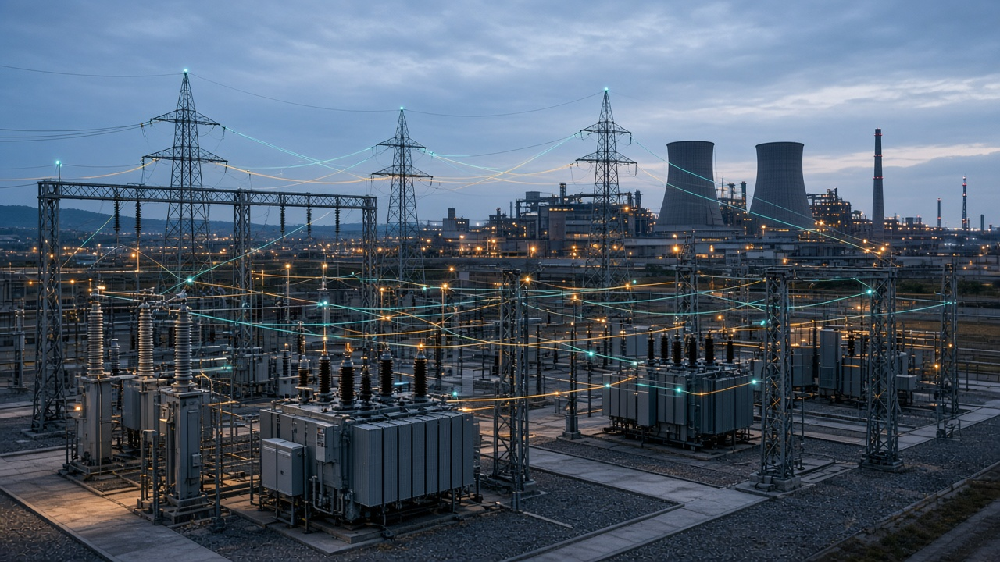

# power-grid-env

**Два отдельных интерфейса:** [сайт и блог](web/README.md) собираются для статического размещения. [Power Grid Studio](studio/README.md) запускается отдельно: конструктор, визуализация, расчётный API и инструменты агента.

**GPU-SFT инженерного агента:** первый закрытый тест из6 синтетических задач выбора кабеля: Qwen3.5-4B0/6→5/6,0.8B0/6→3/6. Три сети/два семейства; text-only, без общей инженерной квалификации. [Область и текущие результаты](plans/CURRENT_STATUS.md).

После расширения учебных состояний4B решает28/30 уже раскрытых регрессионных задач; это не новый независимый тест.

**AC PF:** PQ/I/ZIP-нагрузки, статические генераторы PQ/PV, Q-пределы и обратные потоки доступны в [инженерном веб-интерфейсе](studio/README.md).

**Инженерный веб-интерфейс:** ручные RMS-схемы с трансформаторами, пассивные PF/3ф КЗ, положения аппаратов и обесточенные участки. [Запуск и границы профилей](studio/README.md).

**Ручной конструктор:** шины, линии, двигатели и параметры → проверка → локальный SciPy-расчёт → Grid Studio. [Запуск и профиль](studio/README.md#ручной-конструктор-и-расчёт).

**Grid Studio:** интерактивная схема с потоками, инспектором и осциллограммами на12 записанных физических сценариях. [Запуск и границы](studio/README.md#grid-studio--записанная-физика).

Двухклеточные двигатели с R(T): отдельные токи/потери клеток, общий нагрев
ротора и полное stationary equilibrium —
[R06.40:120 расчётов и66 независимых траекторий](cases/two-cage-winding/README.md).

Совместное RMS electrical/mechanical/thermal equilibrium: скорости, токи и
температуры решаются вместе с проверкой теплового баланса в ваттах —
[профиль R06.39](cases/rms-equilibrium/README.md).

Температурная обратная связь в RMS/DAE: R(T) внутри сетевых матриц и Newton,
128 расчётов и64 независимых траектории —
[профиль R06.38](cases/rms-winding/README.md).

Горячие обмотки, динамические R(T) и КЗ: раздельные температуры статора/ротора,
120 фазных расчётов и60 независимых траекторий —
[профиль R06.37](cases/electrothermal-fault/README.md).

Независимая гибридная динамика OC/UV/thermal защит:78 SI winding trajectories,
отказы выключателей, CT restoration и совпадение с Radau/DAE —
[R06.36: границы и воспроизведение](cases/motor-only-loaded/README.md#r0636--независимая-гибридная-динамика-защит).

Зарегистрированные внешние сравнения AC/pandapower, RMS/ANDES и
full-winding/motulator с явным coverage: [протокол R01.1](docs/COMPARISON_PROTOCOL_RU.md).

Пуск и самозапуск с аудитом энергии вала, I²t, тепловой реплики и проверкой
трёх шагов: [инженерный пакет](docs/MOTOR_ENGINEERING_RU.md).

Непрерывная независимая сверка многоклеточных приводов с насыщением, потерями
и нагревом: [шесть расчётных случаев PHY-20](cases/multicage-continuous/README.md).
Уравнения двух–четырёх клеток записаны отдельно от runtime; одноклеточный предел
проверен с оригинальным motulator. Это ограниченная численная квалификация.

Масштабирование до 2000 узлов / 128 двигателей / 32 генераторов, 45-секундные
острова, каскадные защиты и фазные RLC-переходы проверены отдельными группами:
[матрица PHY-21 и её границы](cases/network-dynamic/README.md).

Проектировщик питающей ветви: проверка всех режимов на трёх сетках, аудит
и раздельные train/dev/test задачи с выбором либо обоснованным отказом:
[профиль DES-01](cases/design-curriculum/README.md).

Выбор кабеля и трансформатора с совместными статическими и динамическими проверками:
[профиль DES-02](cases/equipment-design/README.md).

Опубликованные паспортные данные и прослеживаемая компиляция оборудования:
[каталожный профиль DES-02](cases/equipment-catalog/README.md).

Уставки пуска и дискретное согласование основной/резервной защиты:
[protection screen](cases/protection-screen/README.md).

Замкнутые действия защит и выключателей в моторной сети:
[closed-loop protection](cases/closed-loop-protection/README.md).

Обратнозависимые реле, восстановление часов и16 сочетаний допусков:
[inverse protection](cases/inverse-protection/README.md).

Полный пуск, провалы и самозапуск на всех16 сочетаниях допусков, Radau/DAE:
[full protection envelope](cases/full-protection-envelope/README.md).

Полные матрицы трёх inverse-семейств и проверяемая коррекция резервной уставки:
[VI/EI family qualification](cases/full-inverse-families/README.md).

Генерация проверяемых LLM-задач, SFT-диалоги, физические награды GRPO и локальное
обучение/оценка checkpoint: [руководство](docs/LLM_TRAINING_RU.md).
Первый профиль — восстановление питания; обучение инженерного LLM и превосходство
над другими моделерами пока не заявляются.

[English](README.en.md)

[Текущий статус, открытые блоки и очередь работ](plans/CURRENT_STATUS.md)

Проверки и поставка выполняются локально. CI отключён; агент не выполняет действий на GitHub.



Платформа инженерной проверки алгоритмов управления распределительной сетью. Первая поставка — квазистационарный несимметричный фидер: импорт, preflight, внешний контроллер, набор сценариев восстановления, сравнение с baseline, отчёт и повтор.

Симуляция запускается локально. Кластер, Kubernetes и управление реальной сетью в этот проект не входят.

Симуляция не является допуском к управлению реальной сетью, real-time-режимом или полным EMT.

DAE-решатель, расширенные сети и пакет пуска/самозапуска: [пять реализованных блоков и ограничения](docs/DAE_AND_DOL_BLOCKS_RU.md).

Независимая сетевая сверка расширена на кольцевые схемы с насыщенными двигателями, трансформаторами и несколькими источниками; АВР сверяется с отдельным SI-эталоном.

Полная обмоточная физика двигателей, RMS-защиты/АВР/острова и независимые эталоны: [блоки 6–8, воспроизведение и ограничения](docs/EQUIPMENT_AUTOMATION_VALIDATION_RU.md).

Дополнительно реализованы аналитическая автоматика с DAE, сетевые многоклеточные эталоны, вихретоковые потери, идентификация параметров и фазное КЗ с общей точкой заземления.

## Что проверено и что только реализовано

Статусы лежат в `power_grid_env/capabilities.py`.

Проверено численно на авторских схемах, без натурных осциллограмм:

- фазный режим через OpenDSSDirect / DSS-Extensions: линии, трансформаторы `Dyn11` и `YNd11`, ZIP, КЗ, остров без источника, редукция Крона при явной твёрдой нейтрали;
- импорт DSS площадки 110/10/0.4 кВ: два ввода, LineCode, конденсатор, генератор, накопитель, PV, профиль и Redirect;
- симметричная цепочка этой площадки сходится с фазным OpenDSS лучше чем на 1e-5 о.е. по модулю;
- симметричный AC Ньютона и локальный AC OPF с пределом перетока;
- классическая машина, две машины, ЭДС первого порядка и статизм;
- переходные RL/RLC и сравнение шага dt с dt/2;
- DC-поток, PTDF и линейный WLS на малых схемах.

Реализовано и прогнано сценариями, но не объявлено `validated_for_declared_scope`: восстановление, блокировки, Gymnasium, инструменты LLM, холст VLM, локальный AC OPF. Distance, differential, полный EMT и hardware-in-the-loop остаются за пределами текущей поставки.

Документы требований: [техническое задание](AGENT_IMPLEMENTATION_SPEC_RU.md), [архитектура](IMPLEMENTATION_PLAN_RU.md). При расхождении приоритет у технического задания. Уравнения и допущения: [docs/physics](docs/physics/conventions.md).

## Установка

```bash
pip install -e ".[dev]"
```

Нужны Python 3.11+ и колёса `dss-python` / `opendssdirect.py`.
Для backend ANDES и полной регрессии установите `pip install -e ".[dev,rms]"`;
проверенный эталон ANDES закреплён в отдельном lock-файле EX-02.
`dev` сам по себе не устанавливает внешние моделеры.

## Команды

```bash
power-grid import --source cases/acceptance/feeder_north/feeder.dss \
  --sidecar cases/acceptance/feeder_north/pge-import.yaml \
  --out /tmp/feeder.json --report /tmp/import.json

power-grid preflight /tmp/feeder.json --report /tmp/preflight.json

power-grid suite cases/suites/restoration_v1.yaml --out reports/acceptance

power-grid validate
power-grid accept
power-grid schemas --out /tmp/pge-schemas
power-grid pilot cases/industrial/plant --out /tmp/pilot.json
```

`validate` пишет `reports/validation`. `accept` повторяет приёмку разделов 16–20: чужой DSS, отказ неполного файла, subprocess-контроллеры, suite, HTML, checksums, просмотр, replay, численные проверки, короткий Gymnasium rollout.

Внешний контроллер — отдельный процесс со строками JSON (`initialize`, `reset`, `act`, `close`). Примеры: `examples/controllers`. Subprocess не изолирует файлы и сеть недоверенного кода.

### Пределы на ветви AC-режимов

```bash
power-grid ac-envelope --input cases/ac-envelope/analytic-exits.json --out reports/my-ac-envelope
power-grid verify-ac-envelope reports/my-ac-envelope
```

Продолжение ветви с Q-ограничениями поддерживает мониторинг Vmin/Vmax,
полной мощности на обоих концах ветви и явно заданных токовых пределов в pu.
Сохраняются уточнённые интервалы входа/выхода, исходные нарушения и наихудшие
наблюдённые запасы. `completed=true` означает завершённое исследование;
допустимость точной цели указана отдельно в `target_within_monitored_limits`.
В этом аналитическом примере цель достигается с нарушениями.

IEEE14/30/118 проверены по независимым расчётам pandapower на двух шагах.
Демонстрационные токовые пороги в этих примерах — авторские, не паспортные
амперы оборудования. Монитор не отключает аппараты и не доказывает отсутствие
скрытых пересечений между точками. Подробности — в
[протоколе сравнения](docs/COMPARISON_PROTOCOL_RU.md).

### Распределённая балансировка P/Q

```bash
power-grid ac-dispatch --input cases/ac-dispatch/slack-q-limit.json --out reports/my-ac-dispatch
power-grid verify-ac-dispatch reports/my-ac-dispatch
```

Участники распределяют активный небаланс по явным весам с ограничениями P.
Q-предел прежнего slack может освободить напряжение, сохранив опорный угол;
угловую опору можно задать отдельно. Все исходные Pg должны быть указаны явно.
Тот же профиль подключён к CPF/envelope через `options.dispatch` при
`enforce_q_limits=true`. Динамика частоты и автоматическое образование островов
не моделируются.

### CPF и envelope с распределением нагрузки

```bash
power-grid ac-envelope --input cases/ac-dispatch-arc/analytic-entry.json --out reports/my-dispatch-envelope
power-grid verify-ac-envelope reports/my-dispatch-envelope
```

P-насыщение/возврат участников, Q-пределы всех регулирующих генераторов и сетевые
ограничения проверяются на одной ветви. Отчёт объединяет обнаруженные события
в `timeline_groups`; допустимость точной цели остаётся отдельным признаком.
Чистый CPF-пример: `cases/ac-pseudo-arc/distributed-participation.json`.

## Модель

Канонический JSON не подставляет заземление и группу соединений. Импорт DSS требует sidecar: иначе звезда не считается заземлённой, а `r1/x1` не становятся фазной матрицей. Формат выбран в [ADR 0002](docs/adr/0002-import-format.md).

Повреждённый участок в задаче восстановления известен алгоритму. Сопротивление КЗ, будущий профиль и скрытая метка сценария в наблюдение не входят.

## Длительные исследования

Общий runner возвращает полный фазный результат PF и исполняет QSTS с потоковым журналом, checkpoint и проверяемым продолжением. Подробности и ограничения: [воспроизводимые исследования](docs/DURABLE_STUDIES_RU.md).

```bash
python -m power_grid_env.cli run-study cases/studies/qsts_runtime.json --out /tmp/pge-study
```

RMS из сохранённой симметричной сети поддерживается через `rms/andes`: [модели, единицы и ограничения](docs/CANONICAL_RMS_RU.md).

Расширена поддержка многовольтного RMS и исправлены PV/clock-5 mapping: [результаты и границы масштаба](docs/MULTIVOLTAGE_AND_SCALE_RU.md).

Добавлены регуляторы TGOV1/SEXS/IEEEST, динамические КЗ с очисткой и RMS worker с дедлайном: [запуск, независимые эталоны и ограничения](docs/REGULATED_RMS_AND_FAULTS_RU.md).

GENROU с шестью состояниями и насыщением добавлен в общий RMS adapter: [паспорта, независимые эталоны и примеры](docs/GENROU_RMS_RU.md).

Малосигнальная устойчивость GENCLS/GENROU: матрица DAE, спектр и участие состояний, независимая численная сверка. [Возможности и ограничения](docs/SMALL_SIGNAL_RU.md).

Связанный с сетью динамический пуск асинхронных двигателей: одноклеточная модель третьего порядка, провалы напряжения, выбег/повторное включение и последовательный пуск группы. [Паспорта, примеры и независимая сверка](docs/INDUCTION_MOTOR_RU.md).

Добавлены тепловая память двигателя, отключение по порогу, блокировка повторного включения и строгая сверка I/U/скорости с CSV. [Модель, примеры и границы проверки](docs/MOTOR_THERMAL_AND_VALIDATION_RU.md).

Нагруженная инициализация работающих двигателей, вязкая/квадратичная нагрузка и сглаженное трение, скачки механического момента: [равновесие, независимые эталоны и ограничения](docs/MOTOR_OPERATING_POINT_RU.md).

Добавлен воспроизводимый анализ чувствительности motor study: OAT/Cartesian варианты, собственная инициализация, критерии пуска/восстановления, дедлайны и хешированные артефакты. [Протокол и границы результата](docs/MOTOR_SENSITIVITY_RU.md).

Совместная динамика GENCLS и асинхронных двигателей в одном сетевом решении: нагруженная инициализация, пуск, провал, изменение подачи генератора и моторный thermal trip. [Профиль, независимые проверки и ограничения](docs/COUPLED_GENERATOR_MOTOR_RU.md).

В совместном GENCLS/motor профиле доступны TGOV1 и SEXS: уставки, ограничители и восстановление, независимая SI-сверка и предельный случай ANDES. [Уравнения, воспроизведение и границы](docs/REGULATED_COUPLED_RMS_RU.md).

Совместный профиль расширен GENROU с шестью состояниями: переходные состояния ротора, Ra и насыщение, TGOV1/SEXS, смешанные группы GENCLS/GENROU и двигателей. [Уравнения и восемь независимых сверок](docs/GENROU_COUPLED_RMS_RU.md).

Добавлены конечные симметричные КЗ в совместной динамике и `fault-clearing`: заданные времена отключения, критерии восстановления, isolated worker и хешированные артефакты. [Паспорт, семь SI-сверок и границы вывода](docs/COUPLED_FAULTS_AND_CLEARING_RU.md).

Добавлены IEEEST MODE=1 в общей динамике и `coupled_small_signal`: локальные моды генераторов, моторов и регуляторов, независимая SI/tf2ss сверка и проверка неустойчивых рабочих точек. [Уравнения, примеры и ограничения](docs/COUPLED_PSS_AND_MODES_RU.md).

В совместной динамике доступны `line_open`/`line_close`: оба конца π-линии, зарядка, токи/мощности ветвей и атомарное снятие КЗ с открытием линии. Проверка связности заранее отклоняет острова. [Примеры и независимые проверки](docs/COUPLED_LINE_SWITCHING_RU.md).

Добавлен `generator_open`: электрическое отключение с нулевой сетевой инъекцией, продолжающими движение ротором/регуляторами и измерением AVR со стороны машины. [Семантика, независимые проверки и ограничения](docs/GENERATOR_ELECTRICAL_OPEN_RU.md).

Первый промышленный профиль — пуск и самозапуск двигателей. Добавлен переносимый `motor-bundle` с фиксированными входами/допусками, проверкой всех каналов и отдельным lock чистой установки. [Поставка, воспроизведение и приёмочные ворота](docs/MOTOR_PILOT_DELIVERY_RU.md). Промышленная и натурная квалификация остаются открытыми.

[Внешняя сверка двигателей с ANDES, аналитический Якобиан и протокол масштабирования](docs/MOTOR_EXTERNAL_VALIDATION_AND_SCALE_RU.md).

[Выбег, остаточное напряжение и повторное включение двигателей](docs/MOTOR_COAST_AND_RECLOSE_RU.md).

[Контакторы и автоматический самозапуск при прямом пуске](docs/MOTOR_CONTACTOR_AND_AUTOMATIC_RESTART_RU.md).

[Сравнение выдержек и очередей самозапуска](docs/MOTOR_RESTART_FINITE_STUDY_RU.md).

[Проверка пакетов и полный повтор серий самозапуска](docs/MOTOR_RESTART_AUDIT_AND_REPLAY_RU.md).

[Двухклеточная RMS-модель двигателя и независимые проверки](docs/DOUBLE_CAGE_MOTOR_RU.md).

Проверка проекта не требует собственного оборудования: основа — аналитические эталоны, независимые симуляторы и воспроизводимые публичные кейсы. Опубликованные измерения дополняют этот путь. Добавлена сверка 168 установившихся режимов опубликованного двигателя Aalto с motulator 0.19.0. [Методика, результаты и ограничения](docs/OPEN_REFERENCE_VALIDATION_RU.md).

Добавлен воспроизводимый корпус «пуск → провал → выбег → самозапуск» с ручным запретом, ограничением попыток и тепловой блокировкой. Сверка выполняется с независимой SI-моделью, ANDES и аналитическими законами выбега. [Сценарии и критерии](docs/MULTIBUS_DOL_RESTART_VALIDATION_RU.md).

Расширена независимая сверка общей сети с двигателями на 2–4 генератора GENROU/TGOV1/SEXS: индивидуальные команды, совместная инициализация, перестановки паспортов и смена базиса. Добавлено локальное продолжение бенчмарка с проверкой кеша. [Восемь сценариев, критерии и результаты](docs/MULTI_GENERATOR_VALIDATION_RU.md).

Добавлена [тепловая память статора и защита генераторов](docs/GENERATOR_STATOR_THERMAL_RU.md): непрерывное определение момента отключения, сохранение динамики ротора и охлаждение после открытия. Проверены шесть сценариев с независимой SI-моделью и 18 запусков ANDES строго до открытия генератора; участок после отключения проверен SI-моделью и аналитически.

Для оценки допустимости токового графика и повторных пусков добавлен аналитический расчёт теплового запаса: `python -m power_grid_env.generator_capability cases/studies/generator_thermal_duty.json`.

Реализован [динамический ограничитель перевозбуждения GENROU](docs/GENERATOR_EXCITATION_LIMITS_RU.md): восстановление тока поля из состояний машины, явный базис, обратная связь на SEXS и точные события входа/выхода регуляторов из пределов. Доступны примеры насыщения, восстановления, пуска двигателей и отключения генератора.

После секции возбуждения проверена вся текущая коллекция: **1152 теста**, включая 64 новых, без пропусков и неустранённых ошибок. Полный набор выполнен файловыми пакетами; детали воспроизведения и границы внешних сравнений приведены в документации возбуждения.

Следующий большой пакет объединяет общие точные границы регуляторов, фактические лимиты ресурсов, тепловую память ротора, оценку пуска/самозапуска и проверку радиальных RMS-сетей до 10000 узлов на коротком окне. Добавлен отдельный компонент с полными потоками статора, сверяемый с motulator. [Возможности, команды и проверенные границы](docs/INDUSTRIAL_SEQUENCE_RU.md).


Добавлен конкретный UEL **MNLEX2 OpenIPSL 3.1.0**: собственные базы машин,
обратная связь на AVR, явные состояния и атомарные сбросы, рабочее равновесие
и координация с OEL/защитой поля. Исходный компонент исполняется независимым
OpenModelica/DASSL; полный сетевой контур проверяется отдельной SI-моделью.
[Модель, ограничения и воспроизведение](docs/MNLEX2_VALIDATION_RU.md).

Добавлен восьмисостоянийный **OEL2C** с выдержками, обратнозависимой ветвью,
anti-windup, восстановлением и суммирующей обратной связью в SEXS. Нативный
Modelica-блок через FMI 2 Model Exchange/CVODE замыкается на независимую
SI-сеть с генераторами и двигателями. Вариант `Dynawo cap-guard-v1` явно
отличается от исходника полосой распознавания верхнего предела; исходное
расхождение сохраняется отдельно. Адаптированный файл распространяется по
MPL-2.0, лицензия включена в wheel.
[Уравнения, начальные условия и воспроизведение](docs/OEL2C_VALIDATION_RU.md).

OEL2C теперь поддерживает явное `inactive_equilibrium` для загруженных
генераторов и двигателей: согласованы восемь состояний, anti-windup и
начальная память таймеров. Активные и пограничные начальные точки отклоняются.
[Нативная проверка и условия стационарного режима](docs/OEL2C_EQUILIBRIUM_RU.md).

Реализован `active_limited_equilibrium` OEL2C: загруженная точка при исчерпанном
воздействии PID, явная политика согласования задания AVR и отдельная диагностика
превышения тепловой уставки. Нативная проверка охватывает выход из ограничения
и защиту поля. [Уравнения, аудит задания и область применения](docs/OEL2C_ACTIVE_EQUILIBRIUM_RU.md).

OEL2C поддерживает совместное равновесие сети с заданным током возбуждения и фиксированным входом AVR: начальное напряжение определяется решением, PID остаётся внутри ограничений. Добавлены независимое SI/FMU-решение и сопоставление условных полюсов всего регулирующего контура. [Параметры, примеры и границы проверки](docs/OEL2C_CURRENT_REGULATION_RU.md).

Добавлен `selected_equilibrium` OEL2C: явный выбор стационарной ветви, нейтральная память уставки/PID и касание пределов таймера. Неоднозначные входы отклоняются; стационарность и полная устойчивость различаются в диагностике. [Параметры и независимая проверка](docs/OEL2C_SELECTED_EQUILIBRIUM_RU.md).

Добавлена конечная проверка совпадающих начальных порогов OEL2C: безопасные эквивалентные ветви принимаются, чувствительные точки отклоняются с набором свидетелей. Исходные пороги и физический ток сохраняются. Тепловое сравнение в Python теперь сохраняет исходный порядок операций Modelica, включая случаи чувствительного округления. Проверка включает независимые SI/FMU-точки и фактические производные нативного компонента. [Политика, ограничения и команды](docs/OEL2C_BOUNDARY_POLICY_RU.md).

Добавлен пятисостоянийный ESST1A с явными портами абсолютного takeover OEL,
UEL и дополнительного воздействия. Есть независимая сверка с исходной FMU
OpenIPSL в замкнутой сети, сценарии устранения КЗ и теплового отключения поля.
[Подключения, воспроизведение и границы EX-02](docs/ESST1A_VALIDATION_RU.md).

Для ESST1A добавлена [совместная нативная сверка с MNLEX2](docs/ESST1A_MNLEX2_JOINT_VALIDATION_RU.md):
обе исходные модели OpenIPSL работают в обратной связи общей сети.
Проверяются также сырые состояния и стороны сбросов; чувствительный случай
с двумя UEL выделен как отрицательное свидетельство.

Аудит проверяет весь журнал сбросов и физические каналы даже при ожидаемом
отрицательном результате. Доступна повторная проверка сохранённых доказательств
по закреплённому SHA-256 без повторной сборки FMU; предел событий остаётся 1 мкс.

Добавлена независимая проверка сгущения шага обоих решателей. При причинной
маршрутизации событий FMU подтверждён также стресс-сценарий двух активных UEL:
прежнее расхождение 0,173 с устранено в адаптере эталона. Непрерывные
атомарные корни устранили и оставшееся расхождение почти стационарного случая:
все 13 зарегистрированных сценариев согласуются на двух точностях при
прежнем пределе 1 мкс. Самосходимость не подменяет
сравнение с эталоном.

Причинный валидатор требует аудита исходных условий и обеих сторон каждого
нативного сброса. Запечатанные траектории можно повторно проверить по SHA-256
без исполнения FMU; чувствительность к округлению сохраняется как диагностика.

EX-02 расширен динамическим абсолютным OEL
`FieldCurrentPI_AbsoluteTakeover_v1`, явным подключением IEEEST к ESST1A и
локальным модальным анализом ESST1A/PSS/OEL. Независимые эталоны используют
SI-сеть и зафиксированные FMU OpenIPSL/MSL; реестр совместных воздействий
и модальных случаев — `benchmarks.ex02_cases`.
Это квалификация объявленных инженерных профилей; OEM-регуляторы,
произвольные гибридные моды и EMT этим не покрываются.

Примеры: `power-grid run-study cases/studies/ex02_overload_recovery.json
--out reports/ex02-example` и `power-grid run-study
cases/studies/ex02_modal_avr_pss_oel.json --out reports/ex02-modal`.
Контракт, воспроизведение и разделение зависимостей:
[ESST1A / EX-02](docs/ESST1A_VALIDATION_RU.md).

EX-03 добавляет 45-секундные случаи разгона, выбега, самозапуска и полного
охлаждения, 30-секундную сверку ESST1A и пять измеряемых конфигураций
динамической сети вплоть до `(2000 узлов, 8 двигателей, 4 генератора)`.
Независимая SI/MNA-модель проверяет состояния и комплексные напряжения
всех узлов. [Случаи, точные границы масштаба и воспроизведение](docs/EX03_LONG_RUN_AND_SCALE_RU.md).

Локальная поставка использует [воспроизводимый кандидат поставки](docs/EX04_REPRODUCIBLE_RELEASE_RU.md):
замороженные исходники, офлайн wheelhouse с хешами, лицензии зависимостей,
полный реестр собранных тестов и явные границы профиля Linux x86_64 / Python 3.12.
Прежний внешний EX-04 отменён пользователем; CI, публикация и внешняя подпись
не требуются. Локальные установки проверяют локальную воспроизводимость.

Для фиксированного поля GENCLS добавлен [аналитический якобиан совместной сети](docs/COUPLED_JACOBIAN_RU.md)
с одно- и двухклеточными двигателями и тепловыми репликами. Он учитывает взаимные
влияния машин и пересчитывает отклик после коммутаций. Развитие для GENROU и регуляторов
возбуждения описано в следующих этапах.


[Частично-гладкий аналитический якобиан GENROU/TGOV1/SEXS](docs/GENROU_JACOBIAN_RU.md)
расширяет этот путь на насыщение, непрерывные ветви ограничений регуляторов,
смешанные сети GENCLS/GENROU и тепловые отключения статора. Дальнейшие профили расширяют этот путь на PSS, droop OEL, ESST1A, MNLEX2 и защиту ротора I²; single-OEL2C описан ниже.


[Аналитический профиль IEEEST и droop OEL](docs/PSS_DROOP_JACOBIAN_RU.md)
включает семь состояний PSS, строгую блокировку по напряжению и двухсостоянийную
инженерную обратную связь по току возбуждения. Совместный контур отдельно
сверяется с физической SI-схемой и полиномиальной реализацией PSS.


[Аналитический ESST1A и абсолютный PI OEL](docs/ESST1A_JACOBIAN_RU.md)
добавляет производные пяти состояний возбуждения, селекторов, подвижных границ
выпрямителя и back-calculation. Профиль отдельно сверяется с закреплённым
OpenIPSL/MSL в независимой SI-сети. UEL и OEL2C в этот путь не включены.

MNLEX2 и тепловая защита ротора получили аналитические производные совместно с AVR/PSS/PI-OEL: [область поддержки и воспроизведение NA-05](docs/PROTECTION_JACOBIAN_RU.md).

[Аналитический OEL2C (NA-06)](docs/OEL2C_JACOBIAN_RU.md) добавляет восемь состояний ограничителя и сетевые связи при текущем clock/active set. Автоматический маршрут квалифицируется для одного OEL2C; несколько OEL2C сохраняют FD из-за зафиксированного случая перестановки совпадающих событий.

[NA-07: пакетирование независимых below-clock событий OEL2C](docs/OEL2C_EVENT_BATCH_RU.md) добавляет явную политику `independent_below_clock_batch_v1` для нескольких лимитеров. Legacy-входы сохраняют прежнюю обработку и FD; новый маршрут проверяется отдельными сценариями.

[NA-08: масштабирование сетевых чувствительностей и CSC](docs/JACOBIAN_SCALING_RU.md) ограничивает временные RHS восемью портами и хранит только нужные строки. Явное `jacobian_format: csc` включает точную CSC-передачу в Radau/SuperLU; по умолчанию сохраняется dense. NA-08 использовал плотную сборку; потоковая сборка добавлена в NA-09 ниже.

[NA-09: потоковая сборка CSC](docs/STREAMED_JACOBIAN_RU.md) строит встроенные аналитические якобианы блоками до 32 столбцов, без полной плотной identity/result при больших размерностях. Добавлены проверки 400/424 состояний: 8 генераторов, 32 double-cage двигателя и регуляторы. Итоговая CSC и портовые связи могут оставаться плотными.

[NA-10: независимый восьмимашинный эталон](docs/EIGHT_MACHINE_NATIVE_RU.md) добавляет проверку исходных сценариев NA-09 (8 генераторов, 32 двигателя, PSS и ограничители), токов обеих клеток и теплового отключения с блокировкой повторного пуска. Результат определяется связанным отчётом; общая промышленная квалификация остаётся отдельным вопросом; внешний EX-04 отменён пользователем.

[NA-11: прямые сетевые касательные и J·v](docs/NETWORK_TANGENTS_RU.md) добавляет явный `jacobian_network: direct_solve` для CSC и аналитическое произведение якобиана на векторы без полной матрицы. Портовая квадратная матрица в этих путях не строится; Radau остаётся CSC/SuperLU. Область проверки и ограничения приведены в документе.

### Инженерное рабочее место

Версии исследований, изолированные локальные расчёты, продолжение из checkpoint, сравнение и автономные HTML/CSV/SVG-отчёты: [процесс и команды](docs/ENGINEERING_WORKBENCH_RU.md). Сервисы и CI не требуются.

[B10.2: единый AC-профиль](docs/BALANCED_AC_WORKFLOWS_RU.md) — PF, OPF, AC-оценивание состояния и N−1 на одной схеме, перенос dispatch и проверяемое продолжение.

[Фазная динамика и исследования B11/B12](docs/PHASE_NETWORK_AND_RESEARCH_RU.md): четырёхпроводные RLC-схемы, насыщение, GFL/GFM, DC/Vf-привод, несимметричный Γ-двигатель, гармоники и физически проверяемые surrogate-модели.

Сквозные производные начальных физических состояний RMS доступны через
`power_grid_env.hybrid_sensitivity.run_initial_sensitivity`; независимую сверку
полного расчёта с тремя шагами разностей выполняет `audit_initial_sensitivity`.
Текущий профиль: индукционная сеть, заданные коммутации и тепловые отключения;
совпадающие независимые пороги явно отклоняются. Производные сбросов регуляторов
и автоматических контакторов пока не поддерживаются.

Проверенные публичные параметры и явно заданные механизмы:
`power_grid_env.motor_catalog.catalog_entry` и `catalog_study`.
Повторяемая приёмка: `python -m benchmarks.motor_catalog_acceptance --out <новый-каталог> --wheel <motulator-0.19.0.whl>`.
Длительная кольцевая матрица: `python -m benchmarks.extended_duration_matrix --out <новый-каталог>`.
Подробный статус и оставшиеся ограничения — в [плане](plans/CURRENT_STATUS.md).

В профиле `coincident_roots_v1` TGOV1/SEXS сохраняют свободную производную до
найденного события, затем переходят в режим удержания; аналитические производные
учитывают тот же режим. Это устраняет искусственное запаздывание близких
срабатываний. Актуальные проверки этапа: `reports/remaining-blocks-final-2026-11-06/stage.json`.

### Полные потокосцепленные пуски с защитой и сквозные производные

`python -m power_grid_env.cli protected-motor --catalog aalto-saturated-fan --mode restart --out /tmp/protected-start`
создаёт JSON и автономный HTML-отчёт с разгоном, напряжениями, токами и защитами.
Флаг `--require-acceptable` возвращает ненулевой код при инженерном отклонении.
Редактируемый вход: `cases/protected/restart.json`.

`python -m power_grid_env.cli sensitivity-study --study cases/sensitivity/ats-study.json --protocol cases/sensitivity/ats-request.json --out /tmp/ats-sensitivity`
вычисляет проверяемые численные производные параметров через инициализацию и
события. Неоднозначные направления получают диагностику вместо градиента.
[Приёмка и ограничения](docs/REMAINING_BLOCKS_ACCEPTANCE_RU.md): независимые
эталоны, воспроизведение без сети, точные профили размеров и длительностей.

### Серийные исследования

`python -m power_grid_env.cli campaign run --plan cases/campaign/industrial-21.json --out /tmp/campaign`
запускает 21 проверяемый сценарий с отдельными процессами, критериями и отчётом
HTML/CSV. Доступны сетки параметров, отмена, восстановление по завершённым попыткам,
продолжение в новом каталоге и переносимый ZIP.
[Инструкция и ограничения](docs/ENGINEERING_CAMPAIGNS_RU.md).

Параллельная серия: `python -m power_grid_env.cli campaign run --plan cases/campaign/industrial-21-parallel.json --out /tmp/parallel-study`.
Настройки `maximum_workers` и `memory_budget_mb` ограничивают число процессов
и сумму их резервов памяти. Журнал допусков проверяется вместе с результатами;
[условия параллельного профиля](docs/ENGINEERING_CAMPAIGNS_RU.md#b14-ограниченный-параллельный-запуск).

### Динамическая идентификация двигателя

`python -m power_grid_env.cli identify-dynamic-motor --input cases/dynamic-identification/saturated.json --out /tmp/identified-motor`
подбирает электрические параметры, инерцию и нагрузку по временным рядам U/I/ω.
Приёмка требует свободного воспроизведения отдельных проверочных трасс;
неидентифицируемый результат не получает принятого паспорта. Сохраняются графики,
JSON и происхождение данных. [Метод, единицы и ограничения](docs/DYNAMIC_MOTOR_IDENTIFICATION_RU.md).

### Записи CSV и паспорт двигателя

`python -m power_grid_env.cli motor-recordings import --input cases/motor-recordings/protocol.json --out /tmp/motor-recordings`
готовит синхронные фазные либо αβ-записи с явными единицами и калибровками.
Исходные CSV, диагностика и графики сохраняются в проверяемом переносимом пакете.
`python -m power_grid_env.cli identify-dynamic-motor --recordings /tmp/motor-recordings --out /tmp/motor-identified`
сначала проверяет преобразование по сохранённым исходникам, затем выполняет подбор.
[Формат, готовый пример и границы применимости](docs/MOTOR_RECORDINGS_RU.md).

### Идентификация при шуме и контроль датчиков

`python -m power_grid_env.cli audit-dynamic-motor --input cases/noisy-identification/linear-noise.json --out /tmp/noise-audit`
дополнительно проверяет среднее, RMS и дрейф невязок относительно исходных
наблюдений. Явное сглаживание тренировочной скорости не изменяет hold-out
или данные итоговой приёмки. Доступны изолированные серии и примеры отказа
при ошибках датчиков. [Метод и воспроизводимый корпус](docs/NOISY_IDENTIFICATION_RU.md).

### Калиброванные измерения

`python -m power_grid_env.cli calibrated-motor --input cases/calibrated-motor/study.json --out /tmp/calibrated-motor`
объединяет CSV, явные опоры калибровки и физическую идентификацию. Проверяются
объявленные диапазоны датчиков; неизвестные совместные масштабы датчиков/машины
и неизвестные начальные потоки отклоняются. [Метод, неоднозначность масштаба и ограничения](docs/CALIBRATED_MOTOR_STUDY_RU.md).

### Шумное напряжение и шаги по узлам записи

`python -m power_grid_env.cli calibrated-motor --input cases/sampled-identification/study.json --out /tmp/sampled-motor`
повторяет прежний отказавший 0.01 V опыт методом `sample_rk4` без фильтрации
входа. Метод задаётся явно; DOP853 остаётся по умолчанию.
[Точность, ресурсы и границы переноса](docs/SAMPLED_IDENTIFICATION_RU.md).

### Независимая DC-опора Rs

`python -m power_grid_env.cli anchor-dynamic-motor --input cases/anchored-identification/locked-dc-anchor.json --out /tmp/anchored-motor`
добавляет независимые установившиеся DC U/I данные для Rs при той же температуре.
Номинал и границы допустимого сопротивления проверяются отдельными raw-аудитами.
Это новый условный протокол; он не заменяет отсутствующее измерение истинным
паспортом. [Подключение, пределы и приёмка](docs/STATOR_RESISTANCE_ANCHOR_RU.md).


Разреженный CPF/envelope: профиль масштабирования IEEE118/PEGASE1354 и
авторских сетей 600/2048 узлов, три повтора и независимая электрическая сверка.
IEEE300 и RTE1888 остаются открытыми диагностическими случаями.
Команды и границы измерений: [R03.10](docs/COMPARISON_PROTOCOL_RU.md#r0310--масштабирование-распределённого-cpfenvelope-10-ноября-2026).


Явная подготовка расписаний Pg: `ac-prepare-schedule --input INPUT --out OUTPUT`
и `verify-ac-schedule OUTPUT`. Коррекция сохраняет общую мощность и P-пределы;
электрическая допустимость проверяется отдельным расчётом. Независимая сверка
производного RTE1888: `python -m benchmarks.ac_schedule_acceptance --out reports/ac-admission-local`.


Исследование загрузки с P/Q-ограничениями: `power-grid ac-loading-screen --input cases/ac-loading/ieee300-investigation.json --out reports/loading-local`.
Отдельный CPF на PP-уравнениях подтвердил наблюдаемый разворот IEEE300
при 0.972077896 исходной нагрузки. Это характеристика выбранной ветви,
не сертификат безопасной загрузки или отсутствия иных решений.


Локальные чувствительности нагрузок и рейтинги влияния узлов:
`power-grid ac-sensitivity --input cases/ac-sensitivity/two-bus.json --out reports/sensitivity-demo`.
Прямые и сопряжённые разреженные расчёты проверены независимыми
нелинейными возмущениями IEEE300. Производные возле переключения ограничений
отвергаются; рейтинги не являются рекомендациями управления или сертификатами устойчивости.


Конечные сценарии изменения нагрузок:
`power-grid ac-counterfactual --input cases/ac-counterfactual/two-bus.json --out reports/counter-demo`.
Локальный прогноз сравнивается с полным нелинейным расчётом; P/Q-переключения,
нарушения ограничений и недостигнутая цель сохраняются отдельно. Проверено
242 состояния в шести сценариях независимым электрическим эталоном.


Фазная физика двигателей: смешанный Gc=0/Gc>0 парк, насыщение, 1–4 клетки,
тепловая связь и физическая KCL. Постоянная проводимость вихревых потерь
подключена за Rs; ток потерь исключён из момента. Пять связанных RLC-сценариев
сверены с отдельным потоковым ODE-эталоном. Пример:
`power-grid phase-study run --study cases/phase-core/thermal_multicage.json --out reports/phase-core-local`.
Гистерезис и OEM-точность не заявляются.


Преобразовательный привод: Gc-потери двигателя связаны с выпрямителем,
DC-конденсатором и инвертором; добавлен усреднённый тормозной резистор.
Шесть связанных RLC/V/f-сценариев, включая рекуперацию и undervoltage,
сверены с отдельным all-flux ODE-эталоном. Пример:
`power-grid phase-study run --study cases/vf-core/braking_resistor.json --out reports/vf-core-local`.
Это усреднённая модель с постоянными КПД, без переключений полупроводников и FOC.


### Диодный вход и контур тока привода

Есть отдельный шестипульсный диодный вход с предзарядом от нулевого Udc,
байпасом резистора и запретом обратного потока энергии. Опциональный PI-контур
моторного тока учитывает DC-ограничение напряжения и anti-windup.
Семь готовых исследований — `cases/diode-drive/`; независимая сверка —
`python -m benchmarks.diode_drive_acceptance --out reports/diode-independent`.
Это резистивная коммутация и усреднённый инвертор, не ключевой EMT/FOC.
Подробности и применимость: [R06.3](docs/PHASE_NETWORK_AND_RESEARCH_RU.md).


### Ключевой привод с FOC и тепловой защитой

`power-grid switching-drive run --study cases/switching-drive/foc_start.json --out reports/switching-local`
рассчитывает входные R–L-реакторы, диодный мост, DC-звено, MOSFET-инвертор
с ШИМ/dead time/обратными диодами, sensored rotor-flux FOC и три тепловых узла
с защёлкивающимися отключениями. Семь примеров — `cases/switching-drive/`.
Есть расширение для насыщенной Γ-машины с 1–4 клетками и потерями в стали;
для него явно задаётся отдельная номинальная модель наблюдателя FOC. Уравнения, независимый stage-oracle
и границы: [R06.4](docs/PHASE_NETWORK_AND_RESEARCH_RU.md).


### Насыщение и многоклеточные машины в ключевом приводе

`cases/switching-extended/` содержит семь исследований с 1–4 клетками,
насыщением и вихретоковыми потерями в стали. Дискретный градиент сохраняет
баланс нелинейной магнитной энергии; ток пересчитывается при gate-переключениях.
Независимые winding ODE и связанные stage-oracle:
`python -m benchmarks.switching_extended_acceptance --out reports/extended-independent`.
См. [R06.5: параметры, номинальный FOC и применимость](docs/PHASE_NETWORK_AND_RESEARCH_RU.md).


### Нагрев обмоток и сопротивления R(T)

В ключевом приводе доступны `motor.thermal`, начальные температуры Ts/Tr
и отдельные защёлкивающиеся пороги статора/ротора. Rs/Rr(T) решаются совместно
с электрической частью; потери переходят в тепловую энергию и охлаждение.
Семь примеров: `cases/switching-winding-thermal/`; независимые проверки:
`python -m benchmarks.switching_thermal_acceptance --out reports/winding-thermal-independent`.
FOC пока использует явную номинальную модель. [Границы и результаты R06.6](docs/PHASE_NETWORK_AND_RESEARCH_RU.md).


Новый режим FOC `observer_mode: "multicage_current"` сохраняет все 1–4 клетки
и насыщение отдельного паспорта наблюдателя. Входы — ток и скорость; истинные
потоки/температуры не передаются. Примеры: `cases/multicage-observer/`.
Независимая ODE-проверка и replay: `python -m benchmarks.multicage_observer_acceptance`.
Gc/thermal самого наблюдателя пока не поддерживаются; полное описание и границы —
[R06.7](docs/PHASE_NETWORK_AND_RESEARCH_RU.md).


Импульсная динамика motor+shaft теперь напрямую сверяется с оригинальным
motulator **0.19.0**: `benchmarks.pwm_motor_comparison` и четыре зарегистрированных
протокола `cases/pwm-motor-comparison/`. Проверяются все потоки, токи, момент,
скорость и сходимость по шагу. `--verify` повторяет расчёты. Это заданное
терминальное PWM-напряжение, не полная внешняя схема/FOC и не рейтинг моделлеров.
[Протокол, результаты и ограничения R06.8](docs/COMPARISON_PROTOCOL_RU.md).


Добавлены сверка с motulator **0.23.1** при общих допусках и повторные
wall/CPU/RSS замеры: `python -m benchmarks.pwm_accuracy_budget`.
Независимая замкнутая RL/diode/DC/PWM/FOC/motor проверка ограниченного
линейного профиля: `python -m benchmarks.closed_loop_acceptance`;
готовые исследования — `cases/closed-loop-independent/`.
[Результаты и границы R06.9](docs/COMPARISON_PROTOCOL_RU.md).


Новый runtime API `power_grid_env.prescribed_voltage.voltage_step` ускоряет
Gamma-расчёт при заданном напряжении: точное исключение 1–4 клеток,
насыщение/Gc и связанный вал. На четырёх зарегистрированных motor+shaft
задачах он быстрее native motulator 0.23.1 reference в 1.67–3.13 раза при
прежних error caps. Общая сеть использует прежний Norton-порт;
это не рейтинг всех моделей. [Проверки и границы R06.10](docs/COMPARISON_PROTOCOL_RU.md).


Norton/MNA-путь ключевого привода получил повторное использование матриц и контролируемый direct/SVD
выбор. На восьми зарегистрированных исследованиях измерено **1.14–1.20x**
ускорение относительно прежней реализации с сохранением физических критериев.
Плавающая звезда сохраняет rank-tolerant solve без добавленного заземления.
[Проверки, времена и границы R06.11](docs/COMPARISON_PROTOCOL_RU.md).


Полная независимая замкнутая сверка R06.12 расширена на насыщение, 1/2/4
клетки, потери Gc и тепловые RC/R(T) обмоток:
`python -m benchmarks.extended_closed_loop_acceptance`. Отдельные этапы refinement и
Cauchy temporal-budget сохраняют непрошедшие попытки и возвращают ошибку при
невыполнении критериев. Совпадение уравнений не означает доказанную точность
по времени; double-cage профиль при обычном бюджете остаётся неквалифицированным.
Готовые JSON: `cases/closed-loop-extended-independent/`.
[Результаты, воспроизведение и ограничения R06.12](docs/COMPARISON_PROTOCOL_RU.md).


Публичный `switching-drive qualify` проверяет временную самосогласованность
на последовательных шагах и сохраняет все результаты, отказы и unit caps в
sealed artifact. Доступны API `power_grid_env.switching_convergence`, явный
`step_budget`, CLI `--max-levels`/`--limits` и ZIP. Успешный Cauchy-профиль
не является абсолютной оценкой ошибки или промышленной сертификацией.
[Команды и ресурсы R06.13](docs/PHASE_NETWORK_AND_RESEARCH_RU.md).

R06.13 подтвердил отдельный углублённый double-cage профиль на 39.0625 ns
с явным увеличением бюджета; он требует около миллиона шагов на 40 ms.
Стандартный бюджет корректно сохраняет отказ. [Статус и применимость](plans/CURRENT_STATUS.md).


R06.14 ускоряет прежний расчёт без изменения шагов и результатов: на пяти
40-ms workloads измерено 1.14–1.22x относительно R06.13. Для точного
миллионного double-cage случая медиана снизилась с 267.83 до 219.16 s.
760 selected tests прошли; fresh fine qualification и независимая сверка
сохранены. [Результаты и ограничения](plans/CURRENT_STATUS.md).

R06.15 добавляет **экспериментальный адаптивный midpoint**: задайте
`"adaptive": {}` в switching-drive study для включения. Пробный полный шаг
сравнивается с двумя полушагами; при отказе физическое состояние откатывается.
Нулевой ток источника локализуется отдельно, численная коррекция энергии
записывается в `integration_event_log` и не выдаётся за физическое тепло.
`integration` содержит стоимость проб, отказы и фактически принятые шаги.
Обычный фиксированный шаг остаётся стандартным режимом. Локальный оценщик
не гарантирует глобальную погрешность; `switching-drive qualify` намеренно
отклоняет адаптивный режим. Для сравнения трёх убывающих бюджетов используйте
`python -m benchmarks.switching_adaptive_acceptance --reference-root PATH --out PATH`;
эталонная директория должна содержать четыре `<case>.json` полных результата.
Это проверка относительно архивных расчётов, а не независимый физический эталон.
В матрице R06.15 double-cage проходил бюджет 0.2, но при 0.1 и 0.05
достигал минимального шага. Эти исторические отказы сохранены; последующее
исправление и проверенный профиль описаны в R06.17 ниже.
Готовые входы находятся в `cases/switching-adaptive/`; например:
`power-grid switching-drive run --study cases/switching-adaptive/double_cage.json --out reports/adaptive-example`.
Параметры этих примеров авторские, а не паспорта натурной установки.

R06.16 устраняет воспроизведённый minimum-step сбой у плавающего вывода
двигателя: отдельный Newton-критерий для motor rows и пробный шаг у ближайшей
границы диода. `circuit_solver` допускает `auto` (стандартный legacy для
fixed-step, motor-scaled для adaptive), `legacy` и `motor_scaled`.
Последний можно явно включить для fixed-step исследований. 538 selected
теста прошли; сохранённый отказ проверяется независимыми смешанными
уравнениями. Double-cage 0.1/0.05 теперь завершаются, но пока не проходят
архивные глобальные допуски. Весь adaptive-профиль остаётся экспериментальным.

R06.17 добавляет события нулевого тока двигателя и согласованную обработку
одновременного исчезновения токов свободных фаз. Flux не проецируется;
энергия принимается вместе с native полушагами. **12/12 полных прогонов**
(четыре модели × бюджеты 0.2/0.1/0.05) прошли прежние caps; соседние разности
уменьшаются по установленному критерию 0.85. 564 selected tests, четыре
независимо проверенных event pieces и точный installed-wheel replay.
Это ограниченный authored/reference профиль, не абсолютная погрешность
любой сети и не натурная/OEM квалификация. Исходный fixed-step режим сохранён.

Source workflow после получения sealed runs и архивных reference JSON:
`python -m benchmarks.switching_adaptive_budget_qualification --runs RUNS --reference-root REFERENCES --out OUT`.
Он не ослабляет caps из protocol и проверяет event residuals, counters,
physics audits, соседние разности и reduction. Public fixed-mesh
`switching-drive qualify` по-прежнему предназначен только для fixed steps.

R06.18 проверяет полные траектории другим способом: **8 наших расчётов и
8 непрерывных эталонов** на четырёх авторских сценариях. Неизменённый RHS
двигателя motulator **0.23.1** соединён с независимо записанными source RL,
диодами, DC-шиной, MOSFET/body-diode мостом, FOC/PWM и тепловыми уравнениями.
DOP853 и Radau согласуются в пределах 1% исходных физических допусков;
все наши расчёты проходят сами допуски. Runtime-код проекта запрещён к
импорту в эталонных процессах. Это внешний **моторный компонент**, а не
сравнение целого motulator simulator или универсальный рейтинг.

Исправлен output clock: времена выборок привязаны к заданной сетке,
разрешение ключей на границах блокировки определяется по этому времени.
Электрические снимки остаются pre-switch, разрешение — right-hand policy.
На всех восьми расчётах физические массивы, энергия и counters до/после
совпали в точности; изменились timestamps и четыре boundary labels.
676 selected tests прошли. Готовые случаи — `cases/continuous-drive/`.
Полный reference workflow:
`python -m benchmarks.continuous_drive_acceptance --python REFERENCE_PYTHON --wheel MOTULATOR_WHEEL --out OUT`.
Требуется отдельно установленный проверяемый wheel0.23.1; свежая установка
runtime сама по себе этот optional benchmark не запускает.

Добавлен холодный/горячий экран токов КЗ и достаточных запасов защит: паспортные сопротивления, непрерывные границы пассивного профиля, независимая узловая сверка. Ограничения и команды: [cold/hot envelope](cases/fault-temperature-envelope/README.md).

Подпитка КЗ двигателями: фазовое разложение сети и машин, отдельные токи кабеля/источника и динамическая проверка I²t по портам. [Scope and examples](cases/motor-fault-contribution/README.md).

Работающий двигатель и защиты: отключение сети и погасание полного тока КЗ проверяются раздельно; сохранены отрицательные контроли и критерии нормальных режимов. [Profile and replay](cases/running-fault-protection/README.md).

Проверены все16 сочетаний допусков защит работающего двигателя и найдены реальные контрпримеры прежних уставок. Финальная ревизия0.009/0.0155 прошла612 расчётов матрицы и48 выбранных температурно-вольтажных случаев. [Scope and reproduction](cases/running-fault-corners/README.md).

Полная конечная матрица температуры кабеля, питания и допусков защит:2448 расчётов плюс324 внутренних пробы. Независимый SI winding/DOP853 эталон проверяет15 нормальных траекторий, сравниваемых с обоими native решателями. [Scope and reproduction](cases/running-fault-cartesian/README.md).

Добавлена согласованная нагруженная инициализация motor-only сети без фиктивных генераторов: single/double cage, группы машин, явная thermal policy и диагностика. Независимый SI winding-эталон проверяет loaded normal/programmed-fault dynamics. [Examples and qualification](cases/motor-only-loaded/README.md).

Связанный профиль **GENCLS + двухклеточный двигатель R(T)**: [примеры и воспроизводимая проверка](cases/mixed-winding/README.md). Постоянное возбуждение, согласованная P/V-инициализация при заданных температурах, Radau и DAE; без AVR и совместного теплового равновесия.

Совместное **P/V/load/heat равновесие GENCLS + двигатель R(T)**: [примеры и проверки](cases/mixed-equilibrium/README.md). Температуры вычисляются из теплового баланса; проверяется полный физический спектр. Нагрев самого генератора и AVR пока вне этого профиля.

Регуляторы **TGOV1/SEXS в сети с нагревом двигателя**: [примеры и независимые проверки](cases/controlled-winding/README.md). Поддерживаются три сочетания регуляторов и обе политики начальных температур; подтверждённый профиль остаётся внутри ограничителей.

Гибридные **ограничители TGOV1/SEXS при motor R(T)**: [примеры и независимый эталон](cases/limiter-winding/README.md). Проверены вход в верхнюю/нижнюю границы, удержание, немедленное и отложенное отпускание для заданных импульсных сценариев.

**I²-реплика защиты генератора вместе с motor R(T)**: [профиль и примеры](cases/generator-replica/README.md). Поддержаны стационарная/заданная инициализация и отключение; размерное тепловое состояние генератора в °C этим не моделируется.

**Отключение генератора по I² и режим после размыкания**: [независимая сверка и примеры](cases/generator-trip/README.md). Проверяются время отключения, удаление генератора из сетевого уравнения, работа регуляторов и переход двигателя.

**Температура генератора в °C**: [тепловой наблюдатель и примеры](cases/generator-heat/README.md). Учитывает потери в меди, упрощённые потери в стали, теплоёмкость и теплоотвод; обратное влияние этих потерь на электрическую/механическую мощность GENCLS пока отсутствует.

**Замкнутый бюджет энергии генератора**: [профиль сосредоточенных потерь](cases/generator-energy/README.md). Вал питает выдачу в сеть, тепловые потери и изменение кинетической энергии; отдельно проверяется интеграл мощности. Электрическое падение на сопротивлении статора пока не моделируется.

**Электрическое сопротивление статора генератора R(T)**: [профиль и независимые проверки](cases/generator-stator/README.md). Температура меняет сетевой штамп и падение напряжения; медные потери согласованы с теплом и учитываются в мощности ровно один раз.

**Совместный режим R(T), нагрева и I²-отключения генератора**: [примеры и независимый эталон](cases/stator-trip/README.md). Проверяются размыкание ветви, поведение двигателя, сохранение потерь в стали и энергетический баланс после события.

**R(T), нагрев и ограничения TGOV1/SEXS вместе**: [примеры и независимая сверка](cases/stator-limiter/README.md). Проверяются верхние/нижние ограничения, удержание и отпускание, порядок команд и интегральный баланс энергии.

**Единый гибридный сценарий R(T), ограничителей и I²-защиты**: [примеры и независимая проверка](cases/hybrid-stator/README.md). Проверяет отключение в насыщении, немедленное/отложенное отпускание SEXS и баланс энергии. Исправлена инвалидация сетевого кэша при смене подключений.

**Сетевое токовое реле и выключатель в общем тепловом сценарии**: [три исхода конкуренции защит](cases/network-stator/README.md). Независимо проверены задержка отключения, отказ выключателя и запоздавшая команда после I²-защиты. Исправлена остановка таймера definite-time реле у порога; 32 расчёта Radau/DAE сверены с 16 независимыми траекториями.

**Островной режим и проверяемое восстановление соединения**: [отключение источника/линии и синхроконтроль](cases/topology-stator/README.md). 40 расчётов Radau/DAE сверены с 20 независимыми траекториями: генератор питает двигатель после отделения, обесточенный участок восстанавливается поэтапно, недопустимое включение блокируется. Также исправлена температурная производная тока генератора для inverse-time защит.

**Активные защиты вместе с островом и АПВ**: [четыре OC-кривые, UV, резервирование отказа и повторное отключение](cases/protected-topology/README.md). 72 расчёта Radau/DAE и 36 независимых траекторий проверяют полный цикл защиты, сброс/повторный взвод реле и разные причины блокировки включения. Исправлена потеря точности inverse-time формулы непосредственно у pickup.

**Потеря измерений и АВР с резервным генератором**: [CT/PT continuity и standby transfer](cases/measurement-transfer/README.md). 88 расчётов Radau/DAE сверяются с 44 независимыми траекториями: проверяются память таймеров, восстановление измерений, разрыв перед включением резерва, блокировки и отмена АВР при коротком провале. Для standby явно используются заданные начальные температуры.

**Измерения во время АВР и обратный перевод**: [supply-PT validity, retry и guarded return](cases/transfer-lifecycle/README.md). Добавлены отдельные состояния доступности измерений вводов и повторная проверка перед задержанным включением. Независимо проверены резервный CT, ручной обратный перевод и сохранение запрета оператора после reset. Исправлен порядок почти совпадающих сроков аппаратуры и заданных команд между Radau и DAE.

**Автоматический возврат питания после АВР**: [девять сценариев и запуск](cases/automatic-return/README.md).
Opt-in recovery policy с непрерывной выдержкой и гистерезисом, повторной
проверкой условий при исполнении, break-before-make, отменой/reset pending
return actions и восстановлением резерва при новом провале primary.
88 Radau/DAE расчётов, 44 независимые траектории и 176 сравнений; 384 targeted
теста и 108 same-host installed проверок. Совпавшая ручная команда сохраняется
при отмене политики. Ограниченный авторский warm-standby профиль, не OEM-квалификация.

**Начальные отказы PT и тепловая блокировка генератора**: [восемь сценариев](cases/standby-interlocks/README.md).
Начальная недоступность измерений задаётся в паспорте, сохраняя физическую сеть.
Независимо проверены остывание I2 replica и сохранение запрета ручного/ATS
повторного включения. 80 Radau/DAE runs, 40 независимых траекторий, 160 сравнений;
горячий случай сохраняет ожидаемую блокировку по напряжению. Профиль ограничен
описанной radial-схемой и заданными температурами.

**Явный thermal reset и диагностические эпизоды для агента**: [восемь сценариев и экспорт](cases/thermal-recovery/README.md).
Сброс stator-I2 latch требует отключённого генератора и охлаждения до заданного
порога, сохраняет тепловую память, minimum open time и операторский запрет.
80 Radau/DAE runs, 40 независимых траекторий, 160 сравнений; 520 targeted tests
и 96 installed checks. Подготовлены 18 train-only tool-use эпизодов и строгая
оценка диагностических ответов; экспорты повторены побитово из wheel.
Обучение модели, визуальные данные и независимая оценка остаются открытыми.

**Построение сети агентом и публичные однолинейные схемы**: [примеры и CLI](cases/network-construction/README.md).
Выбор разрешённых трасс, кабелей и трансформатора создаёт фактическую radial LV
сеть. Общие участки учитывают downstream demand; все обязательные пуски и
самозапуск проверяются на трёх сетках. 45 новых dynamic runs, 17 OpenDSS fault
solutions, 157 targeted tests без пропусков и 54 installed replays. SVG/JSON
предложенной схемы не содержат verdict или будущих событий. Проверенный профиль:
3/4 узла, 2/3 двигателя, 400 V, 4 s; широкое проектирование и VLM обучение открыты.

**Мультимодальные наблюдения и входы Qwen3.5**: [корпус, экспорт и API](cases/design-multimodal/README.md).
60 наблюдений объединяют однолинейную схему, паспорт и графики U/I/скорости до
текущего момента. Три топологические семьи разделены на train/dev/test36/12/12;
12 экспортов поддерживают image/text/combined/schematic, SFT только для train.
Нативный процессор Qwen проверен на69 примерах, включая39 assistant-only loss
masks и30 held-out prompts. Есть строгий пакетный diagnostic reward callback.
246 targeted tests без пропусков; корпус и экспорты побитово воспроизведены из
wheel. На этапе R06.62 веса, обучение, качество агента и closed-loop GRPO ещё не проверялись.

**Текущая модель обучения — Qwen3.5-0.8B**: [проверенный CPU-профиль и команды](cases/design-multimodal/QWEN35_08B.md).
Локальные веса, config, tokenizer, processor и shard index закреплены хешами.
Выполнены два квалификационных шага и отдельный проход SFT по всем 36 train-image
наблюдениям. Обучаются 100 352 параметра адаптеров последнего блока декодера;
vision encoder и базовые веса заморожены. Сохранённый safetensors checkpoint
восстанавливает logits побитово. 285 targeted tests (39 новых), плюс повтор
52 тестов в нативном окружении. Это профиль адаптерного обучения на CPU,
не полное дообучение модели и не подтверждение качества инженерного агента.

**Оценка адаптера 0.8B и следующий curriculum**: [протокол, результаты и команды](cases/design-multimodal/QWEN35_08B_EVAL.md).
На неизменённых dev-входах адаптер получил 12/48 против 0/48 у исходной модели:
image 2/12, text и combined по 5/12, schematic 0/12. Все ответы теперь schema-valid,
но ошибки показаний и отказа при недостатке данных сохраняются. Числовой parser
по публичным входам даёт 12/12 в text/combined, поэтому инженерная надёжность
LLM ещё не достигнута. Подготовлены отдельные schema-экспорты: 144 train views и
48 dev prompts; 192 native packs и побитовый installed rebuild. 340 targeted
тестов прошли; на этапе R06.64 curriculum ещё не был обучен, test не использовался.

**R06.65 — смешанный SFT и безопасное продолжение обучения**:
[рецепт и полный результат](cases/design-multimodal/QWEN35_MIXED.md).
Qwen3.5-0.8B прошла144 train views/36 updates с token-weighted accumulation;
сохраняются adapter, AdamW и RNG без pickle. Native installed resume повторяет
шаг побитово;4 заранее выбранные generation replays совпали.400 уникальных
тестов прошли,135 также проверены в native stack. На новых одинаковых schema-dev
входах9/48 против base0/48, но46 ответов почти постоянные, а class-prior control
даёт15/48: **содержательное качество модели не подтверждено**, schematic0/12.
Это другой prompt protocol, его нельзя напрямую сравнивать с прежними12/48.
Подготовлен отдельный **необученный** набор252 train views с реальными ранними
отключёнными состояниями; все300 packs прошли в source/installed, данные
пересобраны побитово. Старые dev/test кадры и public dev inputs сохранены;
test и closed-loop GRPO остаются закрытой/следующей очередью.

**R06.66 — новая физика и train-данные с тремя двигателями**:
[профиль, независимая сверка и воспроизведение](cases/design-multimodal/THREE_MOTOR.md).
Три двигателя на двух нагрузочных узлах проверены в36 новых расчётах;
12 независимых SI-траекторий сверены со всеми тремя сетками. Есть размыкание
и повторное включение каждого вращающегося двигателя,6 новых OpenDSS fault
checks и36 точных installed replays при одинаковом BLAS environment.
Корпус v2 сохраняет реальные версии физики кадров. Подготовлены **636 SFT views**
с двумя/тремя двигателями и48 неизменённых dev prompts;684 native packs
и полная installed пересборка прошли.425 тестов прошли,160 также в native stack.
Нового обучения не было:seen-train probes выявили3/12 и неверный refusal flag
при низком общем loss. Следующая очередь — semantic loss и bounded training
pilot; test закрыт, качество инженерного агента пока не подтверждено.

Agent Lab: локальные задания сборки, диагностики и исправления с физическим PF-проверяющим. 21 сценарий, три разделённые топологии; пока ограниченный профиль. [Запуск и ограничения](studio/README.md).

**Текущий статус данных и обучения — R06.92, 19 ноября 2026**:
[результаты и очередь](plans/CURRENT_STATUS.md), [learning pipeline](plans/LEARNING_PIPELINE.md).
Нативный разбор регрессий подтвердил конфликт gradients, разный per-value вес
loss и каскад ошибок при генерации. Balanced/KL controls не устранили потери.
Добавлен transactional AdamW guard с проверкой12 известных правильных TRAIN
ответов до EOS: все12 сохранены; common focused1/20→5/20, extra4/12→7/12.
Из60 proposals принято22 updates. Inference-only cache frozen prefix побитно
совпал с native logits до/после updates. Full52 gate остаётся failed; это
ограниченное исправление стабильности обучения, не готовый инженерный policy.

Предыдущая focused фаза (R06.91):
1504 новых focused targets прошли native admission. Реальная60-update фаза
улучшила новые probes1/20→14/20, но ухудшила прежние12/20→8/20:4 индивидуальные
регрессии, learning gate failed, адаптер не выпущен. В выбранной учебной смеси
обнаружены4 типа ответов без нужных противоположных классов. Реализована проверка
typed class coverage; новый16-original balanced plan прошёл32 native checks,
но ещё не обучен. Full workflows, heldout model evaluation и VLM остаются открыты.

Предыдущий primitive pilot (R06.90):
Новый primitive curriculum: 8 новых семейств, исключены 17 зарегистрированных
исторических топологий; 780 примеров, train/dev/test разделены до генерации
параметров. Native admission: 416 учебных ответов и 364 запроса heldout без
supervision, ошибок нет. Ограниченный 30-update pilot улучшил exact score
с 1/20 до 12/20 на одной TRAIN-базе и вариантах порядка ключей; полный primitive
gate не пройден. Новые heldout model scores, full workflows и VLM открыты.

Предыдущий exact SFT/v2 (R06.89):
Exact SFT/v2 разделяет реальные/требуемые паспорта и сохраняет tool semantics.
3136 text inputs,192 успешные replayed expert trajectories,3232/3232 native
alternative targets проходят admission; максимум4548 prompt tokens.
Native2-step research smoke обновляет LoRA при frozen base и exact roundtrip.
Continuous2 и chunk1+resume1 побитно совпали по adapter/AdamW/RNG и history.
Это16 TRAIN bases/8 families, не независимый test или обученный VLM-policy;
production learning gate закрыт. Реализованы bounded trainer/resume и отдельный
generated-answer/full-workflow evaluator; полный384-step рецепт ещё не выполнен.
Прежние результаты policy (R06.87):
Qwen3.5-0.8B и native image/text batches проверены, но качество самостоятельного
инженерного агента пока не подтверждено: raw128-step TRAIN run дал0/8 полных
задач, staged last2 physics phase —0/3 на трёх вариантах одной исходной сети.
Это результаты разных интерфейсов; между собой их напрямую не сравнивать.
Native staged API выбирает операцию и затем аргументы без teacher directive;
raw decisions и физический terminal перепроигрываются отдельным verifier.
Распределение loss не заменяет решение задачи. Завершено контролируемое
сравнение depth2→depth8 при прежних данных,78 updates и parent weights:
initial logits/loss совпали побитно на15 входах. Depth8 дал8/15 вместо7/15,
но workflows остались0/3; gain относится только к retention, не planning.
Все эти инженерные ML-прогоны локальные; GitHub/CI не используются.
