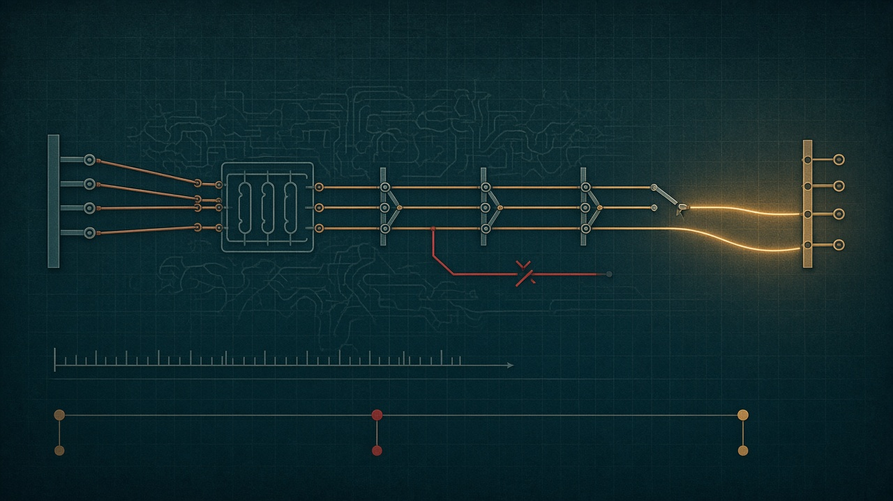

# power-grid-env

[English](README.en.md)



Платформа инженерной проверки алгоритмов управления распределительной сетью. Первая поставка — квазистационарный несимметричный фидер: импорт, preflight, внешний контроллер, набор сценариев восстановления, сравнение с baseline, отчёт и повтор.

Симуляция не является допуском к управлению реальной сетью, real-time-режимом или полным EMT.

## Что проверено и что только реализовано

Статусы лежат в `power_grid_env/capabilities.py`.

Проверено численно на авторских схемах, без натурных осциллограмм:

- фазный режим через OpenDSSDirect / DSS-Extensions: линии, трансформаторы `Dyn11` и `YNd11`, ZIP, КЗ, остров без источника, редукция Крона при явной твёрдой нейтрали;
- классическая машина на шинах бесконечной мощности, неявная трапеция;
- переходные RL/RLC против замкнутых формул;
- DC-поток, PTDF и линейный WLS на малых схемах.

Реализовано и прогнано сценариями, но не объявлено `validated_for_declared_scope`: восстановление, блокировки, Gymnasium, инструменты LLM, холст VLM, локальный AC OPF. Distance, differential, полный EMT и hardware-in-the-loop остаются за пределами текущей поставки.

Документы требований: [техническое задание](AGENT_IMPLEMENTATION_SPEC_RU.md), [архитектура](IMPLEMENTATION_PLAN_RU.md). При расхождении приоритет у технического задания. Уравнения и допущения: [docs/physics](docs/physics/conventions.md).

## Установка

```bash
pip install -e ".[dev]"
```

Нужны Python 3.11+ и колёса `dss-python` / `opendssdirect.py`.

## Команды

```bash
power-grid import --source cases/acceptance/feeder_north/feeder.dss \
  --sidecar cases/acceptance/feeder_north/pge-import.yaml \
  --out /tmp/feeder.json --report /tmp/import.json

power-grid preflight /tmp/feeder.json --report /tmp/preflight.json

power-grid suite cases/suites/restoration_v1.yaml --out reports/acceptance

power-grid validate
power-grid accept
```

`validate` пишет `reports/validation`. `accept` повторяет приёмку разделов 16–20: чужой DSS, отказ неполного файла, subprocess-контроллеры, suite, HTML, checksums, просмотр, replay, численные проверки, короткий Gymnasium rollout.

Внешний контроллер — отдельный процесс со строками JSON (`initialize`, `reset`, `act`, `close`). Примеры: `examples/controllers`. Subprocess не изолирует файлы и сеть недоверенного кода.

## Модель

Канонический JSON не подставляет заземление и группу соединений. Импорт DSS требует sidecar: иначе звезда не считается заземлённой, а `r1/x1` не становятся фазной матрицей. Формат выбран в [ADR 0002](docs/adr/0002-import-format.md).

Повреждённый участок в задаче восстановления известен алгоритму. Сопротивление КЗ, будущий профиль и скрытая метка сценария в наблюдение не входят.
