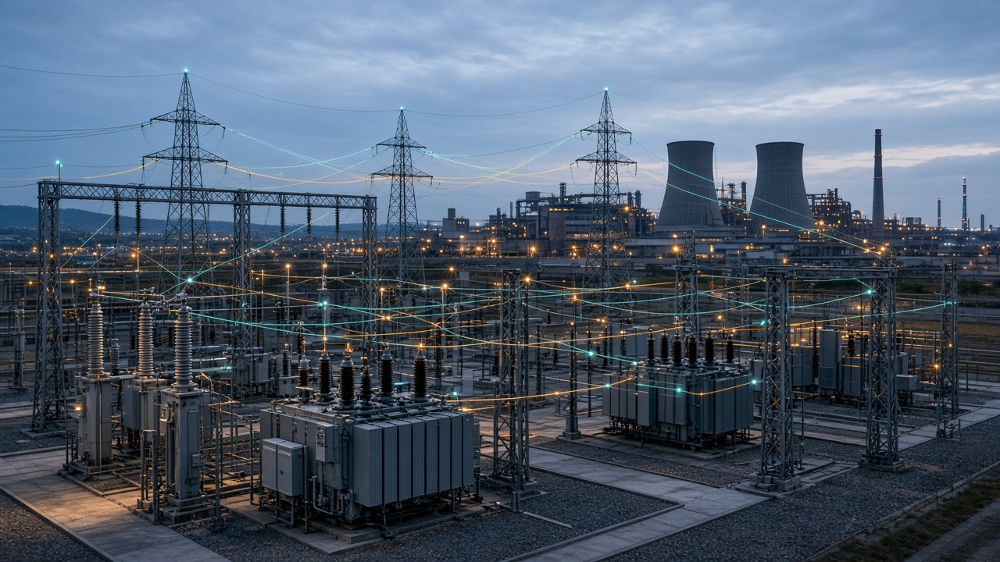

# power-grid-env

[English](README.en.md)



Платформа инженерной проверки алгоритмов управления распределительной сетью. Первая поставка — квазистационарный несимметричный фидер: импорт, preflight, внешний контроллер, набор сценариев восстановления, сравнение с baseline, отчёт и повтор.

Симуляция запускается локально. Кластер, Kubernetes и управление реальной сетью в этот проект не входят.

Симуляция не является допуском к управлению реальной сетью, real-time-режимом или полным EMT.

## Что проверено и что только реализовано

Статусы лежат в `power_grid_env/capabilities.py`.

Проверено численно на авторских схемах, без натурных осциллограмм:

- фазный режим через OpenDSSDirect / DSS-Extensions: линии, трансформаторы `Dyn11` и `YNd11`, ZIP, КЗ, остров без источника, редукция Крона при явной твёрдой нейтрали;
- импорт DSS площадки 110/10/0.4 кВ: два ввода, LineCode, конденсатор, генератор, накопитель, PV, профиль и Redirect;
- симметричная цепочка этой площадки сходится с фазным OpenDSS лучше чем на 1e-5 о.е. по модулю;
- симметричный AC Ньютона и локальный AC OPF с пределом перетока;
- классическая машина, две машины, ЭДС первого порядка и статизм;
- переходные RL/RLC и сравнение шага dt с dt/2;
- DC-поток, PTDF и линейный WLS на малых схемах.

Реализовано и прогнано сценариями, но не объявлено `validated_for_declared_scope`: восстановление, блокировки, Gymnasium, инструменты LLM, холст VLM, локальный AC OPF. Distance, differential, полный EMT и hardware-in-the-loop остаются за пределами текущей поставки.

Документы требований: [техническое задание](AGENT_IMPLEMENTATION_SPEC_RU.md), [архитектура](IMPLEMENTATION_PLAN_RU.md). При расхождении приоритет у технического задания. Уравнения и допущения: [docs/physics](docs/physics/conventions.md).

## Установка

```bash
pip install -e ".[dev]"
```

Нужны Python 3.11+ и колёса `dss-python` / `opendssdirect.py`.

## Команды

```bash
power-grid import --source cases/acceptance/feeder_north/feeder.dss \
  --sidecar cases/acceptance/feeder_north/pge-import.yaml \
  --out /tmp/feeder.json --report /tmp/import.json

power-grid preflight /tmp/feeder.json --report /tmp/preflight.json

power-grid suite cases/suites/restoration_v1.yaml --out reports/acceptance

power-grid validate
power-grid accept
power-grid schemas --out /tmp/pge-schemas
power-grid pilot cases/industrial/plant --out /tmp/pilot.json
```

`validate` пишет `reports/validation`. `accept` повторяет приёмку разделов 16–20: чужой DSS, отказ неполного файла, subprocess-контроллеры, suite, HTML, checksums, просмотр, replay, численные проверки, короткий Gymnasium rollout.

Внешний контроллер — отдельный процесс со строками JSON (`initialize`, `reset`, `act`, `close`). Примеры: `examples/controllers`. Subprocess не изолирует файлы и сеть недоверенного кода.

## Модель

Канонический JSON не подставляет заземление и группу соединений. Импорт DSS требует sidecar: иначе звезда не считается заземлённой, а `r1/x1` не становятся фазной матрицей. Формат выбран в [ADR 0002](docs/adr/0002-import-format.md).

Повреждённый участок в задаче восстановления известен алгоритму. Сопротивление КЗ, будущий профиль и скрытая метка сценария в наблюдение не входят.

## Длительные исследования

Общий runner возвращает полный фазный результат PF и исполняет QSTS с потоковым журналом, checkpoint и проверяемым продолжением. Подробности и ограничения: [воспроизводимые исследования](docs/DURABLE_STUDIES_RU.md).

```bash
python -m power_grid_env.cli run-study cases/studies/qsts_runtime.json --out /tmp/pge-study
```

RMS из сохранённой симметричной сети поддерживается через `rms/andes`: [модели, единицы и ограничения](docs/CANONICAL_RMS_RU.md).

Расширена поддержка многовольтного RMS и исправлены PV/clock-5 mapping: [результаты и границы масштаба](docs/MULTIVOLTAGE_AND_SCALE_RU.md).

Добавлены регуляторы TGOV1/SEXS/IEEEST, динамические КЗ с очисткой и RMS worker с дедлайном: [запуск, независимые эталоны и ограничения](docs/REGULATED_RMS_AND_FAULTS_RU.md).

GENROU с шестью состояниями и насыщением добавлен в общий RMS adapter: [паспорта, независимые эталоны и примеры](docs/GENROU_RMS_RU.md).

Малосигнальная устойчивость GENCLS/GENROU: матрица DAE, спектр и участие состояний, независимая численная сверка. [Возможности и ограничения](docs/SMALL_SIGNAL_RU.md).

Связанный с сетью динамический пуск асинхронных двигателей: одноклеточная модель третьего порядка, провалы напряжения, выбег/повторное включение и последовательный пуск группы. [Паспорта, примеры и независимая сверка](docs/INDUCTION_MOTOR_RU.md).

Добавлены тепловая память двигателя, отключение по порогу, блокировка повторного включения и строгая сверка I/U/скорости с CSV. [Модель, примеры и границы проверки](docs/MOTOR_THERMAL_AND_VALIDATION_RU.md).

Нагруженная инициализация работающих двигателей, вязкая/квадратичная нагрузка и сглаженное трение, скачки механического момента: [равновесие, независимые эталоны и ограничения](docs/MOTOR_OPERATING_POINT_RU.md).

Добавлен воспроизводимый анализ чувствительности motor study: OAT/Cartesian варианты, собственная инициализация, критерии пуска/восстановления, дедлайны и хешированные артефакты. [Протокол и границы результата](docs/MOTOR_SENSITIVITY_RU.md).

Совместная динамика GENCLS и асинхронных двигателей в одном сетевом решении: нагруженная инициализация, пуск, провал, изменение подачи генератора и моторный thermal trip. [Профиль, независимые проверки и ограничения](docs/COUPLED_GENERATOR_MOTOR_RU.md).

В совместном GENCLS/motor профиле доступны TGOV1 и SEXS: уставки, ограничители и восстановление, независимая SI-сверка и предельный случай ANDES. [Уравнения, воспроизведение и границы](docs/REGULATED_COUPLED_RMS_RU.md).

Совместный профиль расширен GENROU с шестью состояниями: переходные состояния ротора, Ra и насыщение, TGOV1/SEXS, смешанные группы GENCLS/GENROU и двигателей. [Уравнения и восемь независимых сверок](docs/GENROU_COUPLED_RMS_RU.md).

Добавлены конечные симметричные КЗ в совместной динамике и `fault-clearing`: заданные времена отключения, критерии восстановления, isolated worker и хешированные артефакты. [Паспорт, семь SI-сверок и границы вывода](docs/COUPLED_FAULTS_AND_CLEARING_RU.md).

Добавлены IEEEST MODE=1 в общей динамике и `coupled_small_signal`: локальные моды генераторов, моторов и регуляторов, независимая SI/tf2ss сверка и проверка неустойчивых рабочих точек. [Уравнения, примеры и ограничения](docs/COUPLED_PSS_AND_MODES_RU.md).

В совместной динамике доступны `line_open`/`line_close`: оба конца π-линии, зарядка, токи/мощности ветвей и атомарное снятие КЗ с открытием линии. Проверка связности заранее отклоняет острова. [Примеры и независимые проверки](docs/COUPLED_LINE_SWITCHING_RU.md).

Добавлен `generator_open`: электрическое отключение с нулевой сетевой инъекцией, продолжающими движение ротором/регуляторами и измерением AVR со стороны машины. [Семантика, независимые проверки и ограничения](docs/GENERATOR_ELECTRICAL_OPEN_RU.md).

Первый промышленный профиль — пуск и самозапуск двигателей. Добавлен переносимый `motor-bundle` с фиксированными входами/допусками, проверкой всех каналов и отдельным lock чистой установки. [Поставка, воспроизведение и приёмочные ворота](docs/MOTOR_PILOT_DELIVERY_RU.md). Промышленная и натурная квалификация остаются открытыми.

[Внешняя сверка двигателей с ANDES, аналитический Якобиан и протокол масштабирования](docs/MOTOR_EXTERNAL_VALIDATION_AND_SCALE_RU.md).

[Выбег, остаточное напряжение и повторное включение двигателей](docs/MOTOR_COAST_AND_RECLOSE_RU.md).

[Контакторы и автоматический самозапуск при прямом пуске](docs/MOTOR_CONTACTOR_AND_AUTOMATIC_RESTART_RU.md).

[Сравнение выдержек и очередей самозапуска](docs/MOTOR_RESTART_FINITE_STUDY_RU.md).

[Проверка пакетов и полный повтор серий самозапуска](docs/MOTOR_RESTART_AUDIT_AND_REPLAY_RU.md).

[Двухклеточная RMS-модель двигателя и независимые проверки](docs/DOUBLE_CAGE_MOTOR_RU.md).

Проверка проекта не требует собственного оборудования: основа — аналитические эталоны, независимые симуляторы и воспроизводимые публичные кейсы. Опубликованные измерения дополняют этот путь. Добавлена сверка 168 установившихся режимов опубликованного двигателя Aalto с motulator 0.19.0. [Методика, результаты и ограничения](docs/OPEN_REFERENCE_VALIDATION_RU.md).

Добавлен воспроизводимый корпус «пуск → провал → выбег → самозапуск» с ручным запретом, ограничением попыток и тепловой блокировкой. Сверка выполняется с независимой SI-моделью, ANDES и аналитическими законами выбега. [Сценарии и критерии](docs/MULTIBUS_DOL_RESTART_VALIDATION_RU.md).

Расширена независимая сверка общей сети с двигателями на 2–4 генератора GENROU/TGOV1/SEXS: индивидуальные команды, совместная инициализация, перестановки паспортов и смена базиса. Добавлены продолжение бенчмарка с проверкой кеша и отдельный CI-job. [Восемь сценариев, критерии и результаты](docs/MULTI_GENERATOR_VALIDATION_RU.md).

Добавлена [тепловая память статора и защита генераторов](docs/GENERATOR_STATOR_THERMAL_RU.md): непрерывное определение момента отключения, сохранение динамики ротора и охлаждение после открытия. Проверены шесть сценариев с независимой SI-моделью и 18 запусков ANDES строго до открытия генератора; участок после отключения проверен SI-моделью и аналитически.

Для оценки допустимости токового графика и повторных пусков добавлен аналитический расчёт теплового запаса: `python -m power_grid_env.generator_capability cases/studies/generator_thermal_duty.json`.

Реализован [динамический ограничитель перевозбуждения GENROU](docs/GENERATOR_EXCITATION_LIMITS_RU.md): восстановление тока поля из состояний машины, явный базис, обратная связь на SEXS и точные события входа/выхода регуляторов из пределов. Доступны примеры насыщения, восстановления, пуска двигателей и отключения генератора.

После секции возбуждения проверена вся текущая коллекция: **1152 теста**, включая 64 новых, без пропусков и неустранённых ошибок. Полный набор выполнен файловыми пакетами; детали воспроизведения и границы внешних сравнений приведены в документации возбуждения.

Следующий большой пакет объединяет общие точные границы регуляторов, фактические лимиты ресурсов, тепловую память ротора, оценку пуска/самозапуска и проверку радиальных RMS-сетей до 10000 узлов на коротком окне. Добавлен отдельный компонент с полными потоками статора, сверяемый с motulator. [Возможности, команды и проверенные границы](docs/INDUSTRIAL_SEQUENCE_RU.md).


Добавлен конкретный UEL **MNLEX2 OpenIPSL 3.1.0**: собственные базы машин,
обратная связь на AVR, явные состояния и атомарные сбросы, рабочее равновесие
и координация с OEL/защитой поля. Исходный компонент исполняется независимым
OpenModelica/DASSL; полный сетевой контур проверяется отдельной SI-моделью.
[Модель, ограничения и воспроизведение](docs/MNLEX2_VALIDATION_RU.md).

Добавлен восьмисостоянийный **OEL2C** с выдержками, обратнозависимой ветвью,
anti-windup, восстановлением и суммирующей обратной связью в SEXS. Нативный
Modelica-блок через FMI 2 Model Exchange/CVODE замыкается на независимую
SI-сеть с генераторами и двигателями. Вариант `Dynawo cap-guard-v1` явно
отличается от исходника полосой распознавания верхнего предела; исходное
расхождение сохраняется отдельно. Адаптированный файл распространяется по
MPL-2.0, лицензия включена в wheel.
[Уравнения, начальные условия и воспроизведение](docs/OEL2C_VALIDATION_RU.md).
